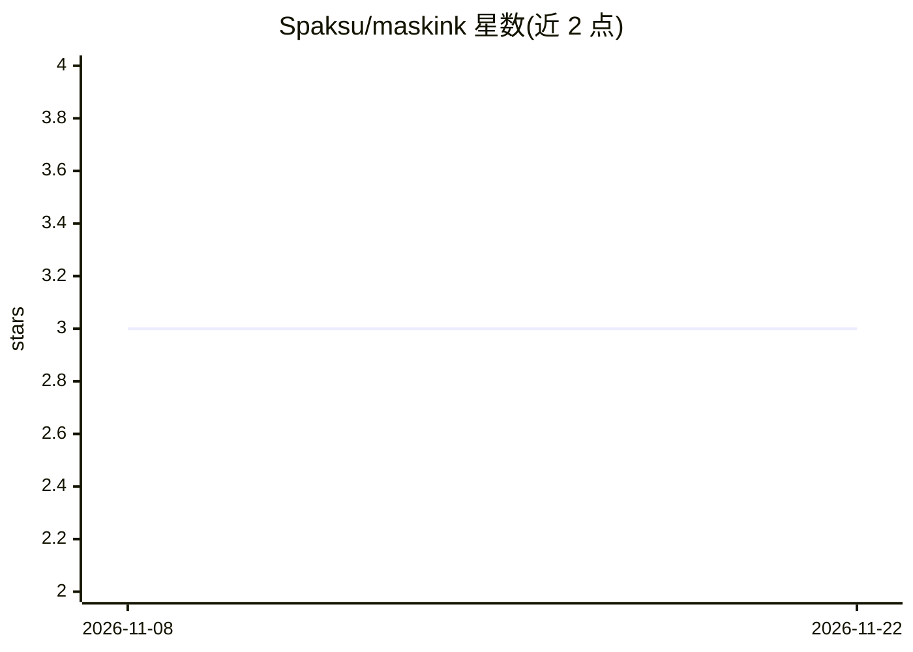

# Spaksu/maskink

⭐ 3 · PHP · MIT · 推送 2026-11-08 · [GitHub](https://github.com/Spaksu/maskink) · 个人维护

**在文本发送给 AI 前做规则化脱敏并还原回复的工具**

Maskink 用 95 条内置规则（regex、key=value、字典）把日志、bash/PowerShell/Python 脚本和聊天消息中的 IP、主机名、用户名、密码、API/SSH 密钥等敏感值替换为一致性占位符，AI 回复在浏览器端通过映射表一键还原为真实值。AI 聊天仅在服务端脱敏后发送掩码历史，聊天与映射只存浏览器 localStorage。需 PHP 8.1+、MySQL/MariaDB 与 Apache，无安装向导与 Composer。附 GitHub Pages 在线演示（掩码引擎移植为 JS，回复为模拟样本）。

## 筛选速览

| 维度 | 判定 | 备注 |
|---|---|---|
| AI 角色 | `ai-enhanced` | 去掉 AI 部分产品仍成立 |
| 许可风险 | `permissive` | MIT |
| 部署形态 | `None` |  |
| 模型依赖 | local-ok | 支持本地模型 |
| 硬件要求 | — | 无带数字的原话,不猜 |
| 安装摩擦 | `low` | 无编译、无系统依赖或容器化 |
| 成熟度 | — | 结构信号不足 |

## 能力要点

- 一致性占位符：同一值在全文与整个会话中使用相同 token，支持跨位置传播
- 95 条内置规则加自定义规则，含 TCKN/IBAN/卡号校验（Luhn/mod-97）与风险行警告
- 浏览器端 OCR 处理截图文字并对敏感区域打码（本地 Tesseract.js）
- 支持 vLLM 网关、Ollama、NVIDIA API 及 OpenAI 兼容连接，聊天仅存浏览器

## 适用场景

- 把交换机/防火墙/服务器日志发给 AI 前先脱敏
- 让 AI 分析运维脚本但隐藏密码与密钥
- 与 AI 对话时不暴露内网 IP、主机名与用户信息

## 场景标签

 · 领域:隐私/安全工具

## 证据(README 行号)

> L5: **Redact your logs, scripts and chat messages before they reach an AI, and get the real values back in the reply.**
> L11: Maskink replaces sensitive values in switch, firewall, NAC, server and application logs and in bash / PowerShell / 
> L76: ### AI chat

## 星数曲线

2026-11-08 3 → 2026-11-22 3（+0）

---
*卡片 v1 · prompt 1.4 · 生成 2026-11-22 · 置信度 high · 依据 README sha `4528f8675b49` · [字段定义](../../DATASET.md)*
