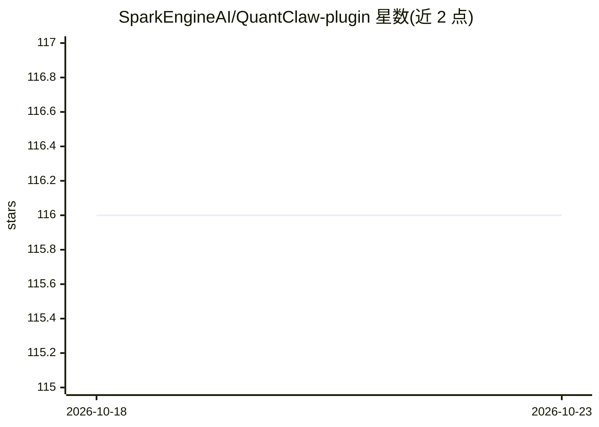

# SparkEngineAI/QuantClaw-plugin

⭐ 116 · TypeScript · MIT · 推送 2026-04-27 · [GitHub](https://github.com/SparkEngineAI/QuantClaw-plugin) · [官网](https://sparkengineai.github.io/QuantClaw/) · 组织维护 · 中文 README

**OpenClaw 的任务类型路由量化插件：按请求分级调度精度**

面向 OpenClaw 的即插即用插件：对每条进入的请求先经规则检测器分类，未命中再由 judge 模型判定任务类型，映射到 4bit/8bit/16bit 精度层并路由到对应模型目标，以平衡质量、延迟与成本。判定依据来自对 24 类任务、104 个任务、6 个模型（9B-744B）的量化研究。支持每层独立 provider/endpoint/定价、配置热重载及 dashboard 观测路由与成本；本地嵌入路由器可选 CUDA 或 CPU 运行。

## 筛选速览

| 维度 | 判定 | 备注 |
|---|---|---|
| AI 角色 | `ai-ecosystem` | LLM/agent 周边工具 |
| 许可风险 | `permissive` | MIT |
| 部署形态 | `None` |  |
| 模型依赖 | — | README 未给出锁定关系 |
| 硬件要求 | — | 无带数字的原话,不猜 |
| 安装摩擦 | `medium` | 含编译或系统依赖之一 |
| 成熟度 | — | 结构信号不足 |

## 能力要点

- 规则优先、judge 模型兜底的请求分类，映射 4bit/8bit/16bit 精度层
- 基于 24 任务类型、104 任务、6 模型的量化研究结论
- 每精度层可配置独立 provider、模型、endpoint、API key 与定价
- 配置文件热重载与内置 dashboard 观测路由/tokens/成本

## 适用场景

- OpenClaw 部署中按任务敏感度自动选择量化精度以控制成本
- 为编码、安全等高敏感任务保留高精度，低敏感任务走低精度
- 追踪各精度层的路由决策与 token 成本

## 场景标签

`模型量化` · 领域:训练与推理

## 证据(README 行号)

> L15: QuantClaw is a plug-and-play task-type routing quantization plugin for OpenClaw. It classifies each incoming reques
> L70:  Rules first, then a judge model for requests.

## 星数曲线

2026-10-18 116 → 2026-10-23 116（+0）

---
*卡片 v1 · prompt 1.4 · 生成 2026-10-23 · 置信度 high · 依据 README sha `d428e212110c` · [字段定义](../../DATASET.md)*
