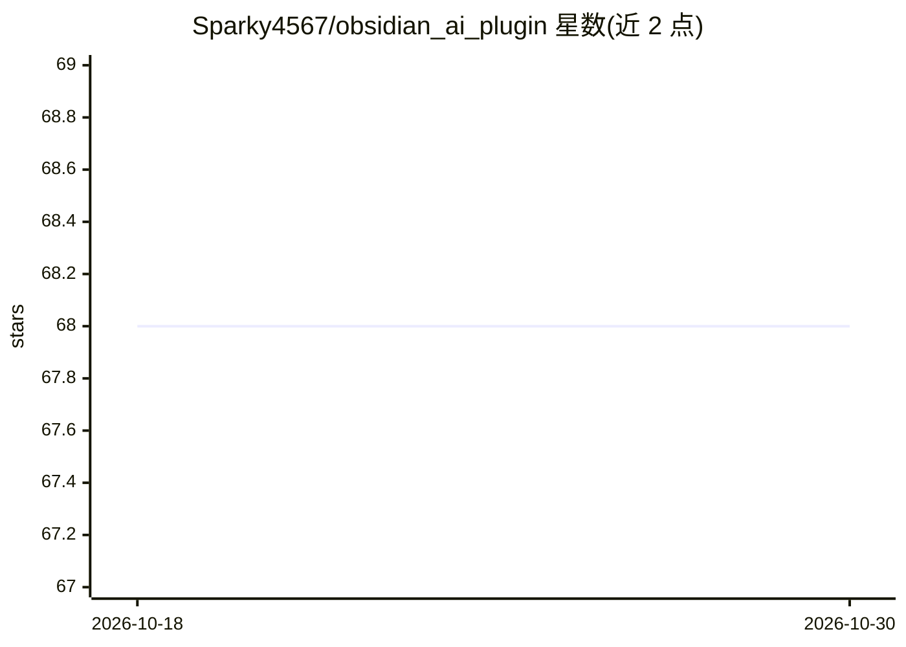

# Sparky4567/obsidian_ai_plugin

⭐ 68 · JavaScript · Apache-2.0 · 推送 2026-08-06 · [GitHub](https://github.com/Sparky4567/obsidian_ai_plugin) · [官网](https://github.com/Sparky4567/obsidian_ai_plugin) · 个人维护

**Obsidian 本地 LLM 插件：在笔记内调用 Ollama 对话与续写**

面向 Obsidian（桌面与移动端）用户的零依赖本地 LLM 插件：连接本地或自托管 Ollama 实例，提供侧边栏聊天面板（流式输出、停止生成、消息历史）与笔记内命令（总结选中文本、续写故事、生成故事、修语法、解释文本）及快捷提示按钮。可在设置中配置 Ollama 端点、选择模型与系统角色。移动端需在同一网络内自托管 Ollama。安装方式为 git clone 源码构建或下载 Release 文件放入插件目录。

## 筛选速览

| 维度 | 判定 | 备注 |
|---|---|---|
| AI 角色 | `ai-native` | 本体是模型或模型工具 |
| 许可风险 | `permissive` | Apache-2.0 |
| 部署形态 | `library` | 以包/库形式分发 |
| 模型依赖 | local-ok | 支持本地模型 |
| 硬件要求 | — | 无带数字的原话,不猜 |
| 安装摩擦 | `low` | 无编译、无系统依赖或容器化 |
| 成熟度 | — | 结构信号不足 |

## 能力要点

- 侧边栏聊天面板：流式输出、实时状态、停止生成与消息历史
- 笔记内命令：总结/续写故事/修语法/解释选中文本
- 支持桌面与移动端，零第三方 node 依赖
- 设置中可配置 Ollama 端点、自动发现模型并测试连接

## 适用场景

- 在 Obsidian 笔记中直接调用本地模型续写或改写文本
- 通过侧边栏与本地 LLM 对话而不离开笔记应用
- 手机端 Obsidian 连接局域网内自托管的 Ollama

## 场景标签

`AI 写作` `聊天机器人` · 领域:对话与助手

## 证据(README 行号)

> L7: A fast, lightweight, zero-dependency local LLM plugin for **Obsidian** (Desktop & Mobile). Connect seamlessly to you
> L15:  - `Ask LLM with selected text`
> L71: 4. The generated response will stream directly under or in place of your selection.

## 星数曲线

2026-10-18 68 → 2026-10-30 68（+0）

---
*卡片 v1 · prompt 1.4 · 生成 2026-10-24 · 置信度 high · 依据 README sha `b9e690b98c1d` · [字段定义](../../DATASET.md)*
