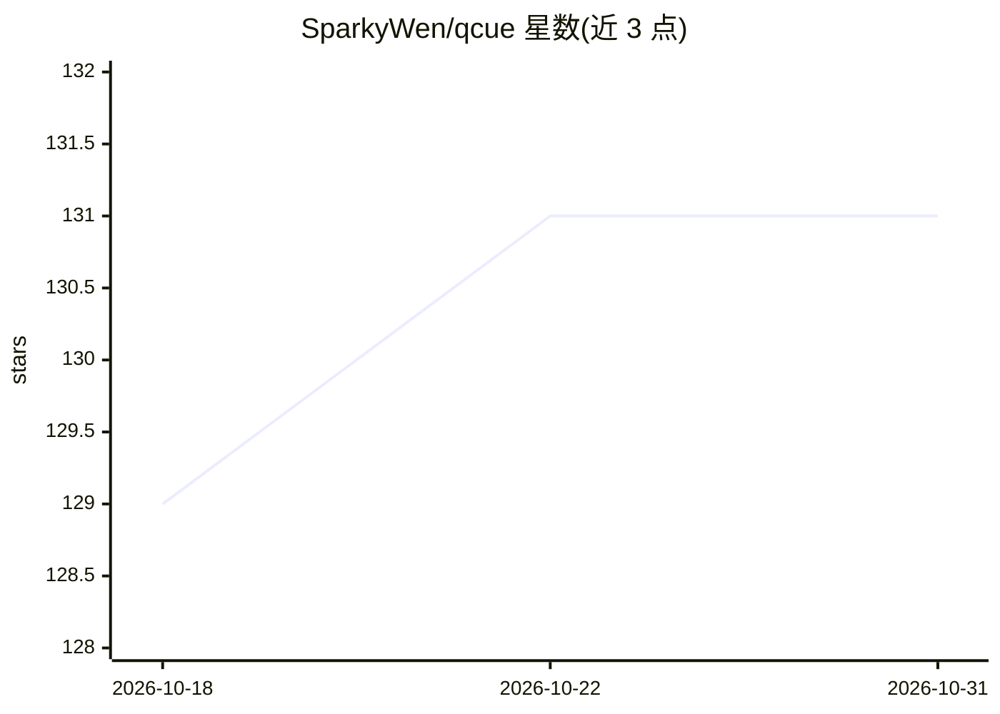

# SparkyWen/qcue

⭐ 131 · Rust · AGPL-3.0 · 推送 2026-06-30 · [GitHub](https://github.com/SparkyWen/qcue) · [官网](https://www.qcue.cn) · 个人维护 · 中文 README

**给个人用户的 AI "第二大脑"：捕捉想法并整理为可检索的 Markdown wiki**

开源的捕捉式个人知识管理系统：用户以文字或语音把想法记入每日 feed，自带 LLM key（BYOK）的模型将其蒸馏为带 [[wikilinks]] 链接的 Markdown wiki（Obsidian 兼容），支持自然语言 agentic recall 检索问答与每夜的 Auto-Dream 整理（调用前检查成本、经可逆审批门）。技术栈为 Rust/Axum 多租户后端（PostgreSQL 16 行级安全 + Redis 7）与离线优先的 Flutter 应用（Android/iOS），提供无 key 无网络的 stub 模式，多 provider 可切换回退。面向个人用户与自托管开发者。

## 筛选速览

| 维度 | 判定 | 备注 |
|---|---|---|
| AI 角色 | `ai-native` | 本体是模型或模型工具 |
| 许可风险 | `viral` | AGPL-3.0 |
| 部署形态 | `None` |  |
| 模型依赖 | — | README 未给出锁定关系 |
| 硬件要求 | — | 无带数字的原话,不猜 |
| 安装摩擦 | `low` | 无编译、无系统依赖或容器化 |
| 成熟度 | — | 结构信号不足 |

## 能力要点

- BYOK 自带模型 key，provider 无关，会话可在不同模型间回退
- LLM 蒸馏为 [[wikilinks]] 互链的 Markdown wiki，Obsidian 兼容
- 离线优先 Flutter 应用 + 无 key 无网络 stub 模式全流程可运行
- 多租户隔离由 PostgreSQL 行级安全强制执行

## 适用场景

- 随手记录文字或语音想法，自动整理成个人知识库
- 用自然语言检索和询问自己积累的笔记
- 离线（如飞机上）捕捉想法，联网后幂等同步

## 场景标签

`知识库管理` · 领域:知识与检索

## 证据(README 行号)

> L21: QCue is an open-source knowledge, memory, and semantic-recall system. Dump fleeting ideas — typed or
> L22: spoken — into a fast daily feed; a bring-your-own-key LLM continuously distills that stream into a
> L23: persistent, interlinked **Markdown wiki** (`[[wikilinks]]`, an `index.md`, a `log.md`) that you can
> L36: |🔗 **LLM-wiki**|A BYOK model distills your feed into a Karpathy-style Markdown wiki of entity / concept / source pa

## 星数曲线

2026-10-18 129 → 2026-10-31 131（+2）

---
*卡片 v1 · prompt 1.4 · 生成 2026-10-22 · 置信度 high · 依据 README sha `a4cd67f3a6b9` · [字段定义](../../DATASET.md)*
