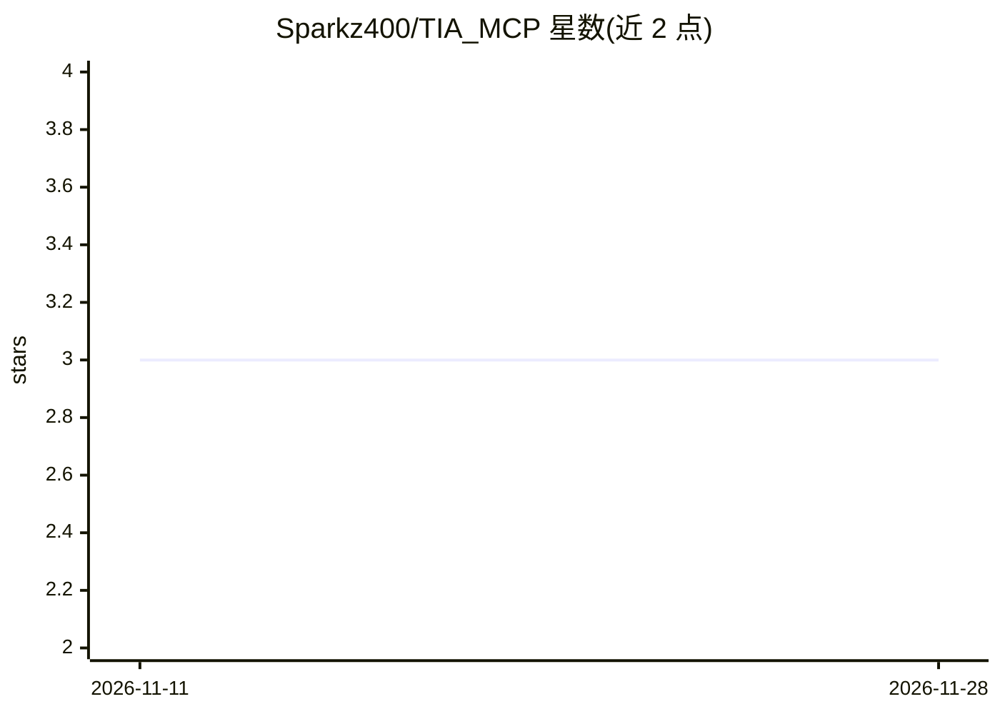

# Sparkz400/TIA_MCP

⭐ 3 · C# · Apache-2.0 · 推送 2026-11-27 · [GitHub](https://github.com/Sparkz400/TIA_MCP) · 个人维护

**面向 MCP 客户端的 TIA Portal V21 离线工程工具服务器**

Windows 上的 MCP 服务器，让 MCP 客户端以自然语言检查离线 TIA Portal V21 项目并进行可恢复修改（准备/预览/检查点/应用/验证），并通过 PLCSIM Advanced V8 做仿真测试。提供项目清单、调用图、变更影响、健康报告、离线文档与 Git 版本管理等工具集，默认仅暴露约 70/320 个工具以控制上下文成本。pre-1.0 阶段，仅限离线项目与自有模拟器，物理 PLC 在线访问默认关闭且未完成资格验证；独立项目，与西门子无隶属关系。

## 筛选速览

| 维度 | 判定 | 备注 |
|---|---|---|
| AI 角色 | `ai-ecosystem` | LLM/agent 周边工具 |
| 许可风险 | `permissive` | Apache-2.0 |
| 部署形态 | `desktop` | 安装包/桌面程序 |
| 模型依赖 | — | README 未给出锁定关系 |
| 硬件要求 | — | 无带数字的原话,不猜 |
| 安装摩擦 | `medium` | 含编译或系统依赖之一 |
| 成熟度 | `idea` | |

## 能力要点

- 检查点与日志支撑的可恢复工程修改流程
- 无需安装西门子软件的离线可移植工作流（便携包）
- PLCSIM Advanced V8 仿真实例创建与块测试断言
- toolsets 分组控制工具列表与上下文成本

## 适用场景

- 离线检查 TIA Portal 项目结构、调用关系与变更影响
- 带检查点的安全块/标签/硬件修改与回滚
- 用 PLCSIM 仿真验证逻辑（如 Motor_On 跟随 Start）
- 导入审查文档、OPC UA NodeSet、AutomationML 等做离线比对

## 场景标签

 · 领域:工业自动化/工程工具

## 证据(README 行号)

> L8: A Windows MCP server that lets an MCP client inspect and make recoverable changes
> L9: to offline **TIA Portal V21** projects, with simulation through **PLCSIM Advanced V8**.
> L153: Without `--toolsets` the Host advertises only the `base` and `core` tools (about 70 of roughly 320) to keep

## 星数曲线

2026-11-11 3 → 2026-11-28 3（+0）

---
*卡片 v1 · prompt 1.4 · 生成 2026-11-22 · 置信度 high · 依据 README sha `cd62812c7fa6` · [字段定义](../../DATASET.md)*
