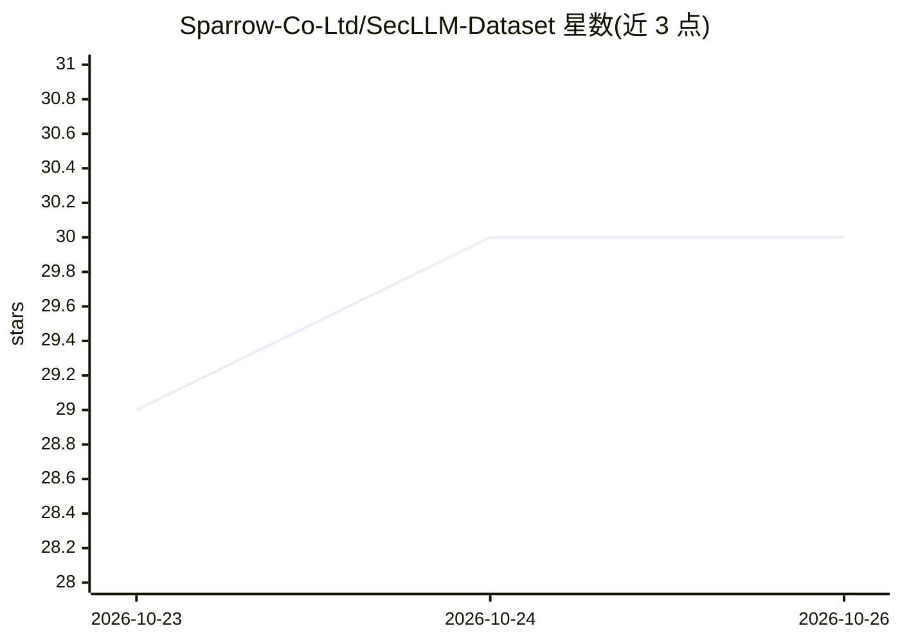

# Sparrow-Co-Ltd/SecLLM-Dataset

⭐ 30 · Python · CC-BY-4.0 · 推送 2026-10-24 · [GitHub](https://github.com/Sparrow-Co-Ltd/SecLLM-Dataset) · 组织维护

**SAST 产出的安全漏洞数据集：供 LLM 训练检测/解释/修补漏洞**

由 Sparrow Co., Ltd. 维护的静态分析安全漏洞数据集：从真实开源代码中用 Sparrow SAST 检出漏洞，以 JSON Lines 记录，每条含完整源文件、漏洞行号、韩/英双语类型描述与安全/危险示例、source→branch→sink 污点流，以及经 SAST 复验的修复补丁。覆盖 Java/JavaScript/TypeScript/Python/Go/C++/C 七种语言共 15,042 条核心记录，另有 1,231 条无补丁测试记录；社区层接受 Semgrep/CodeQL 等第三方工具贡献。提供 validate.py 脚本校验 schema 与统计，仅依赖 Python 标准库。

## 筛选速览

| 维度 | 判定 | 备注 |
|---|---|---|
| AI 角色 | `ai-knowledge` | 知识聚合/清单类 |
| 许可风险 | `viral` | CC-BY-4.0 |
| 部署形态 | `None` |  |
| 模型依赖 | — | README 未给出锁定关系 |
| 硬件要求 | — | 无带数字的原话,不猜 |
| 安装摩擦 | `medium` | 含编译或系统依赖之一 |
| 成熟度 | — | 结构信号不足 |

## 能力要点

- 每条记录含完整源文件、污点流轨迹与经 SAST 复验的修复补丁
- 7 种语言、共 15,042 条核心记录 + 1,231 条独立测试记录
- 韩/英双语的漏洞类型描述与安全/危险代码示例
- 提供仅依赖 Python 标准库的 schema 校验与统计脚本

## 适用场景

- 训练/评测 LLM 做漏洞检测、解释生成与补丁生成
- 研究 LLM 在程序修复任务上的推理路径学习
- 用测试集（无公开补丁）做漏洞修补能力的盲评

## 场景标签

`网络安全` `模型评测` · 领域:评测与运维

## 证据(README 行号)

> L8: > **A static-analysis-based dataset for training LLMs to detect, explain, and patch security vulnerabilities**
> L10: SecLLM-Dataset collects security vulnerabilities that a static application security testing (SAST) tool
> L11: found in real open-source code, packaged as JSON Lines for LLM training and evaluation.

## 星数曲线

2026-10-23 29 → 2026-10-26 30（+1）

---
*卡片 v1 · prompt 1.4 · 生成 2026-10-26 · 置信度 high · 依据 README sha `5d02d57dbb11` · [字段定义](../../DATASET.md)*
