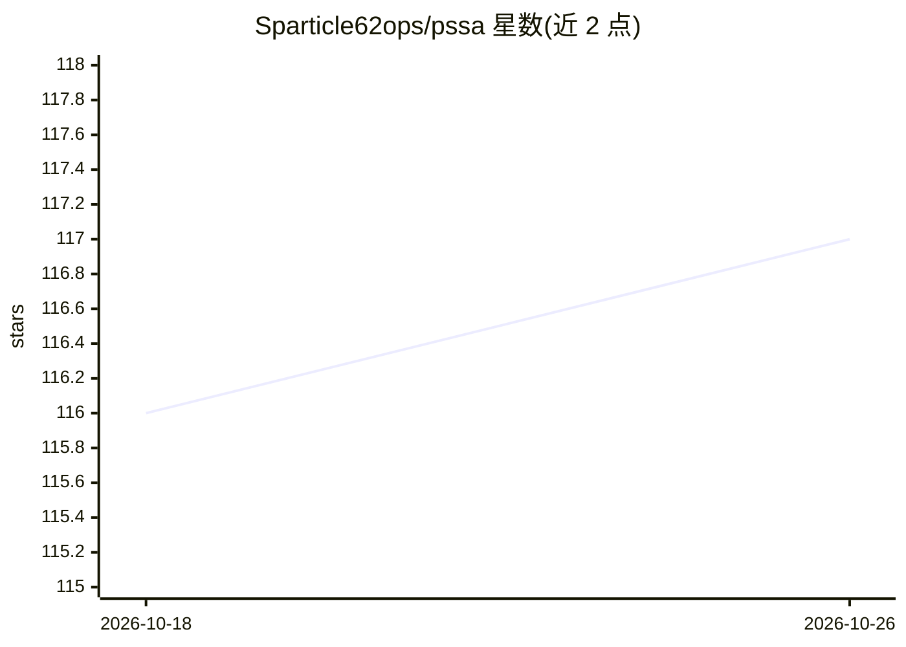

# Sparticle62ops/pssa

⭐ 117 · Rust · GPL-3.0 · 推送 2026-10-24 · [GitHub](https://github.com/Sparticle62ops/pssa) · [官网](https://sparticle62ops.github.io/pssa-site/) · 个人维护

**用 Rust 从零实现的非 Transformer 语言模型（塑性状态空间架构）**

PSSA 是一个用 Rust 从零编写的小型语言模型，不依赖 PyTorch/TensorFlow 等任何 ML 框架。其架构包含：逐 token 的选择性状态空间递归层（S4/Mamba 同族）、双曲空间中的情景记忆库读写（带新颖性写入规则与不应期计数器）、运行时的自修正权重（快速塑性更新经岭回归回写到转移矩阵）。提供 CLI 训练/评分命令与 TUI 仪表盘，支持 CUDA 训练后端，并含一个 CPU only 的 boxes-world 递归世界模型实验。面向语言模型架构研究者的研究性实现。

## 筛选速览

| 维度 | 判定 | 备注 |
|---|---|---|
| AI 角色 | `ai-native` | 本体是模型或模型工具 |
| 许可风险 | `viral` | GPL-3.0 |
| 部署形态 | `library` | 以包/库形式分发 |
| 模型依赖 | — | README 未给出锁定关系 |
| 硬件要求 | — | 无带数字的原话,不猜 |
| 安装摩擦 | `high` | 编译与系统依赖俱全 |
| 成熟度 | — | 结构信号不足 |

## 能力要点

- 选择性对角 SSM 递归 + 双曲空间情景记忆读写 + 岭回归权重固化的塑性架构
- Rust 从零实现，无 PyTorch/TensorFlow 等框架依赖，梯度对参考实现误差约 3e-8
- 训练损失安全守卫：连续可疑损失组时中止且不写检查点
- 记忆库容量增长与可选 CPU top-k 精确近邻读取（实验性）

## 适用场景

- 研究和实验非 Transformer 的状态空间语言模型架构
- 在同一语料上对比 PSSA 与 Transformer 的训练/生成表现
- 探索情景记忆与自修正权重（塑性）在语言建模中的作用

## 场景标签

`模型训练` `科研工具` · 领域:学习与行业

## 证据(README 行号)

> L7: PSSA is a small language model that is not a transformer. It reads text one
> L10: runs. It is written in Rust from scratch, with no PyTorch, no TensorFlow, and no
> L146: Every token goes through one PSSA layer: a selective state-space recurrence,

## 星数曲线

2026-10-18 116 → 2026-10-26 117（+1）

---
*卡片 v1 · prompt 1.4 · 生成 2026-10-23 · 置信度 high · 依据 README sha `86c43824ed30` · [字段定义](../../DATASET.md)*
