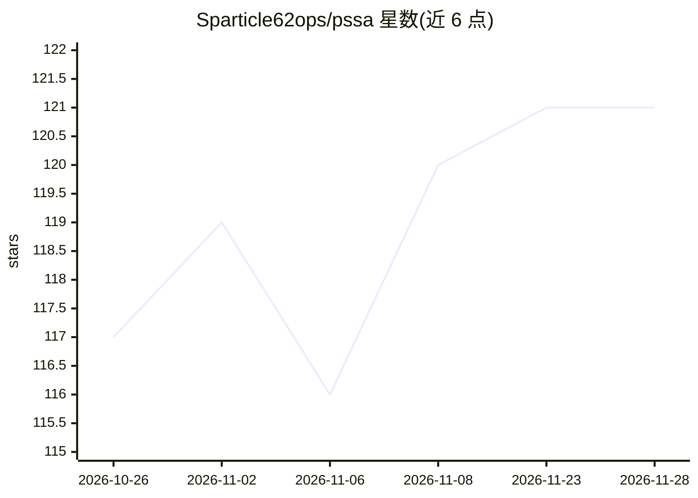

# Sparticle62ops/pssa

⭐ 121 · Rust · GPL-3.0 · 推送 2026-11-19 · [GitHub](https://github.com/Sparticle62ops/pssa) · [官网](https://sparticle62ops.github.io/pssa/) · 个人维护

**Rust 从零实现的非 Transformer 语言模型，供研究者训练实验**

用 Rust 无框架从零编写的语言模型：循环状态空间层替代注意力、512 槽双曲检索的情景记忆库、可塑权重在运行时自我更新并通过岭回归固化，训练走手写 CUDA（cuBLAS）路径，CPU 标量参考用于梯度校验。附带终端仪表盘，所有仪表盘功能均有对应 CLI 命令，可在 SSH/脚本中使用。README 明确当前为 1.5M 参数级别的研究原型，文本质量与规模化表现均有未验证项。

## 筛选速览

| 维度 | 判定 | 备注 |
|---|---|---|
| AI 角色 | `ai-native` | 本体是模型或模型工具 |
| 许可风险 | `viral` | GPL-3.0 |
| 部署形态 | `library` | 以包/库形式分发 |
| 模型依赖 | — | README 未给出锁定关系 |
| 硬件要求 | — | 无带数字的原话,不猜 |
| 安装摩擦 | `medium` | 含编译或系统依赖之一 |
| 成熟度 | `idea` | |

## 能力要点

- 循环状态空间核心，固定状态长度，不做全上下文注意力
- 512 槽情景记忆库（Poincaré 双曲检索）与可塑权重闭环固化
- 纯 Rust 手写线性代数，CUDA 训练路径与 CPU 参考梯度校验
- 终端仪表盘与等价 CLI 命令，支持 Hugging Face checkpoint 转换

## 适用场景

- 在 CPU 或入门级 GPU 上复现参数对齐的语言模型对比实验
- 研究状态空间模型与在线权重可塑性的机制
- 作为无深度学习框架的语言模型教学/参考实现

## 场景标签

`模型训练` · 领域:训练与推理

## 证据(README 行号)

> L9: PSSA is a small language model that is not a transformer. It reads text one
> L12: runs. It is written in Rust from scratch, with no PyTorch, no TensorFlow, and no
> L88: Running it with no arguments opens the dashboard. Everything the dashboard does

## 星数曲线

2026-10-26 117 → 2026-11-28 121（+4）

---
*卡片 v1 · prompt 1.4 · 生成 2026-11-28 · 置信度 high · 依据 README sha `e45e6867ae61` · [字段定义](../../DATASET.md)*
