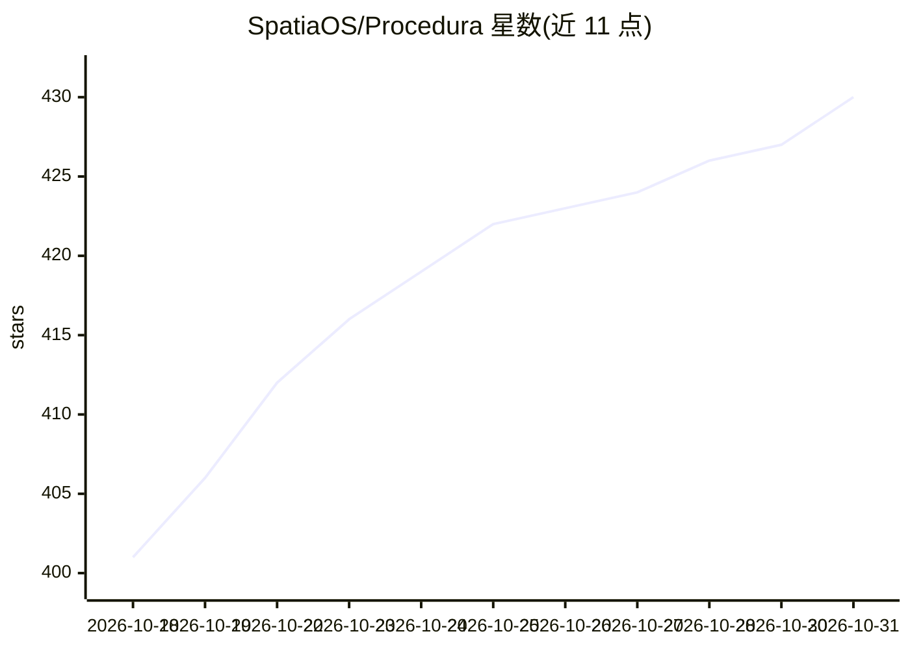

# SpatiaOS/Procedura

⭐ 430 · TypeScript · MIT · 推送 2026-10-20 · [GitHub](https://github.com/SpatiaOS/Procedura) · [官网](https://spatiaos.github.io/projects/procedura/) · 组织维护

**文本/图像生成可编辑参数化 3D 模型的 MCP 工具**

Procedura 将文本描述或参考图转换为可编辑的 3D 模型：逐部件构建、形状检查与改进、添加材质，并导出 OpenSCAD 源码、OBJ 网格、带材质版本，以及 USD/URDF 运动件文件。它以 MCP 方式运行在 Codex 或 Claude Code 内，复用当前会话的模型，无需单独 API key（也可走 API key 模式）。安装脚本目前支持 Linux x86_64，会安装 Bun、OpenSCAD、Blender 与 Python 包；物理检查需另行安装 Isaac Sim，缺失则跳过。

## 筛选速览

| 维度 | 判定 | 备注 |
|---|---|---|
| AI 角色 | `ai-native` | 本体是模型或模型工具 |
| 许可风险 | `permissive` | MIT |
| 部署形态 | `None` |  |
| 模型依赖 | — | README 未给出锁定关系 |
| 硬件要求 | — | 无带数字的原话,不猜 |
| 安装摩擦 | `low` | 无编译、无系统依赖或容器化 |
| 成熟度 | — | 结构信号不足 |

## 能力要点

- 文本或参考图逐部件生成可编辑参数化模型
- 导出 final.scad / OBJ / 带材质模型与 USD/URDF 运动件文件
- 通过 MCP 在 Codex 或 Claude Code 内运行，复用会话模型，无需单独 key
- 含形状检查、材质、运动测试的完整流水线，报告列出失败或跳过的步骤

## 适用场景

- 从一段文字或一张 PNG 参考图得到可继续编辑的参数化 3D 模型
- 在 Codex/Claude Code 会话里直接驱动建模流水线
- 生成带运动件的模型并导出 USD/URDF 用于机器人等场景

## 场景标签

 · 领域:3D 生成/参数化建模

## 证据(README 行号)

> L11: **Procedura** turns text or a reference image into a 3D model you can edit.
> L15: **Run it inside Codex or Claude Code through MCP.** It uses the model in your

## 星数曲线

2026-10-18 401 → 2026-10-31 430（+29）

---
*卡片 v1 · prompt 1.4 · 生成 2026-10-21 · 置信度 high · 依据 README sha `3e57d49c5046` · [字段定义](../../DATASET.md)*
