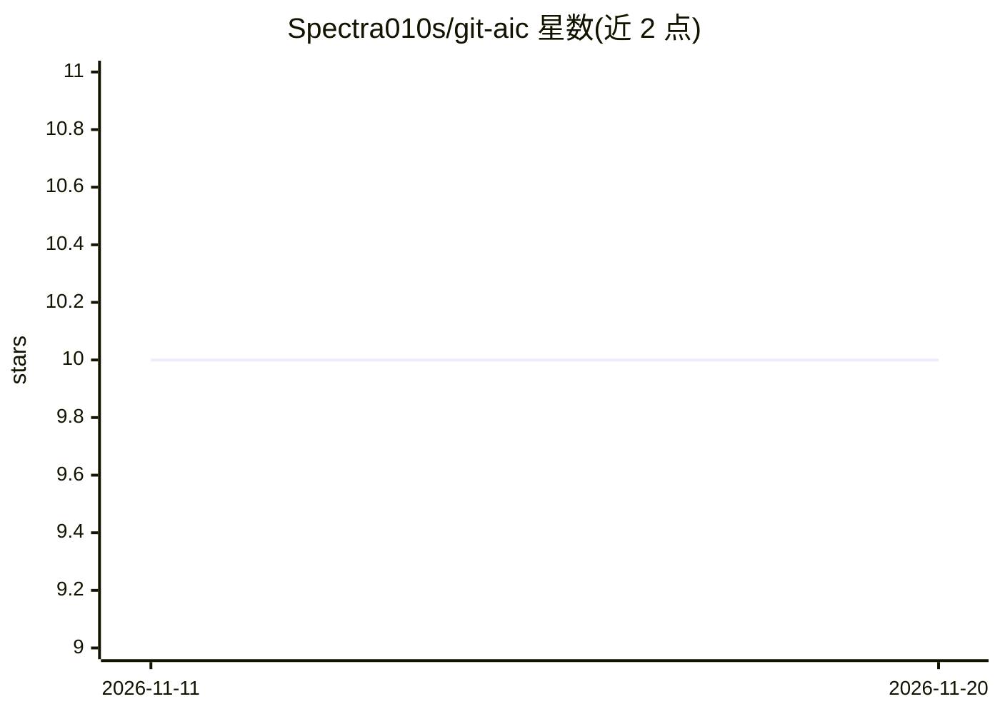

# Spectra010s/git-aic

⭐ 10 · TypeScript · ISC · 推送 2026-11-11 · [GitHub](https://github.com/Spectra010s/git-aic) · [官网](https://git-aic.pages.dev) · 个人维护

**AI 生成 Git 提交信息的命令行工具：分析暂存改动并给出建议**

一个 Node.js 编写的 Git 子命令式 CLI 工具（git aic），读取暂存区 diff，调用 Google Gemini 或 OpenAI API 生成符合 Conventional Commits 规范的提交信息，用户可选择接受、在编辑器中修改、重试或拒绝。支持自定义系统提示词、全局/仓库/本地三级配置作用域、交互式配置向导、环境变量注入 API key，并附带 issue 关联（--issue）与提交后自动推送（-p）选项，按需运行、无后台进程。

## 筛选速览

| 维度 | 判定 | 备注 |
|---|---|---|
| AI 角色 | `ai-native` | 本体是模型或模型工具 |
| 许可风险 | `permissive` | ISC |
| 部署形态 | `library` | 以包/库形式分发 |
| 模型依赖 | — | README 未给出锁定关系 |
| 硬件要求 | — | 无带数字的原话,不猜 |
| 安装摩擦 | `low` | 无编译、无系统依赖或容器化 |
| 成熟度 | — | 结构信号不足 |

## 能力要点

- 分析暂存 diff 并生成 Conventional Commits 规范的提交信息
- 支持 Gemini 与 OpenAI 两种 provider 及自定义模型名
- 全局/仓库/本地三级配置作用域与交互式配置向导
- 生成结果可接受/编辑/重试/拒绝，支持 --issue 与 -p 推送

## 适用场景

- 让 AI 根据暂存改动自动起草规范的 commit message
- 团队统一提交信息风格与 Conventional Commits 规范
- 提交时自动关联 GitHub issue 并推送

## 场景标签

`代码生成` · 领域:编码与开发

## 证据(README 行号)

> L7: Git-AIC is a command-line interface (CLI) tool that helps you write perfect Git commit messages every time. It uses 
> L18:  It taps into Google Gemini or OpenAI APIs to analyze your Git diff and suggest descriptive, conventional commit me
> L85: npm i -g git-aic

## 星数曲线

2026-11-11 10 → 2026-11-20 10（+0）

---
*卡片 v1 · prompt 1.4 · 生成 2026-11-20 · 置信度 high · 依据 README sha `9ea1d004db7a` · [字段定义](../../DATASET.md)*
