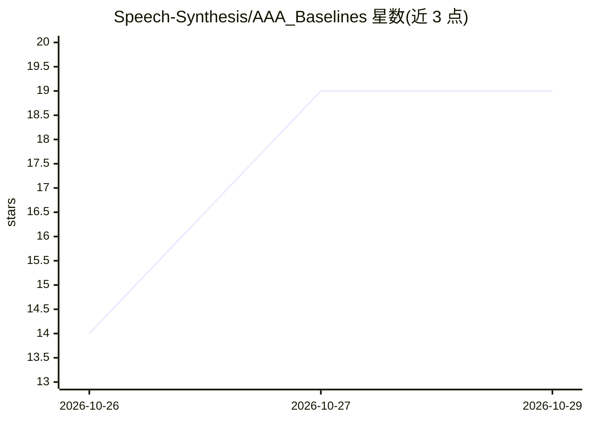

# Speech-Synthesis/AAA_Baselines

⭐ 19 · Python · MIT · 推送 2026-10-26 · [GitHub](https://github.com/Speech-Synthesis/AAA_Baselines) · 组织维护

**多层声纹认证系统：深伪检测+说话人验证+短语核验**

面向语音身份认证场景的研究项目，采用 FastAPI + React 18 + PostgreSQL 架构，音频需依次通过四层安全检查：基于 Wav2Vec2 的深伪检测（ASVspoof 2019 LA 训练）、基于 Whisper 的挑战短语 ASR 核验（Levenshtein 相似度）、基于 ECAPA-TDNN 的说话人验证（192 维嵌入余弦相似度）、以及 HMAC-SHA256 单次令牌与 EMA 声纹自适应更新。提供 REST API（注册/注册声纹/挑战/验证）、Docker 部署与 Swagger 文档；总端到端延迟约 1.1 秒，首次请求有 8-12 秒模型加载冷启动。

## 筛选速览

| 维度 | 判定 | 备注 |
|---|---|---|
| AI 角色 | `ai-native` | 本体是模型或模型工具 |
| 许可风险 | `permissive` | MIT |
| 部署形态 | `self-host` | docker 或自建部署 |
| 模型依赖 | — | README 未给出锁定关系 |
| 硬件要求 | — | 无带数字的原话,不猜 |
| 安装摩擦 | `low` | 无编译、无系统依赖或容器化 |
| 成熟度 | — | 结构信号不足 |

## 能力要点

- 四层串联验证：深伪检测、短语 ASR 核验、说话人验证、挑战-响应令牌
- ECAPA-TDNN 192 维声纹嵌入与 EMA 声纹演化更新
- 单次 HMAC 令牌（90 秒 TTL）防重放攻击
- Docker 多阶段构建部署，生产用 PostgreSQL、开发用 SQLite

## 适用场景

- 对语音克隆与 AI 深伪攻击有防护需求的声纹登录系统
- 需要挑战短语防重放的语音身份验证
- 研究多层语音认证流水线的基线实现

## 场景标签

`网络安全` · 领域:学习与行业

## 证据(README 行号)

> L36: |L2 Model|Wav2Vec2 (HuggingFace)|Deepfake detection|
> L37: |ASR Model|Whisper (OpenAI)|Speech-to-text|
> L103: |Model|`speechbrain/spkrec-ecapa-voxceleb`|

## 星数曲线

2026-10-26 14 → 2026-10-29 19（+5）

---
*卡片 v1 · prompt 1.4 · 生成 2026-10-28 · 置信度 high · 依据 README sha `30c3700952e9` · [字段定义](../../DATASET.md)*
