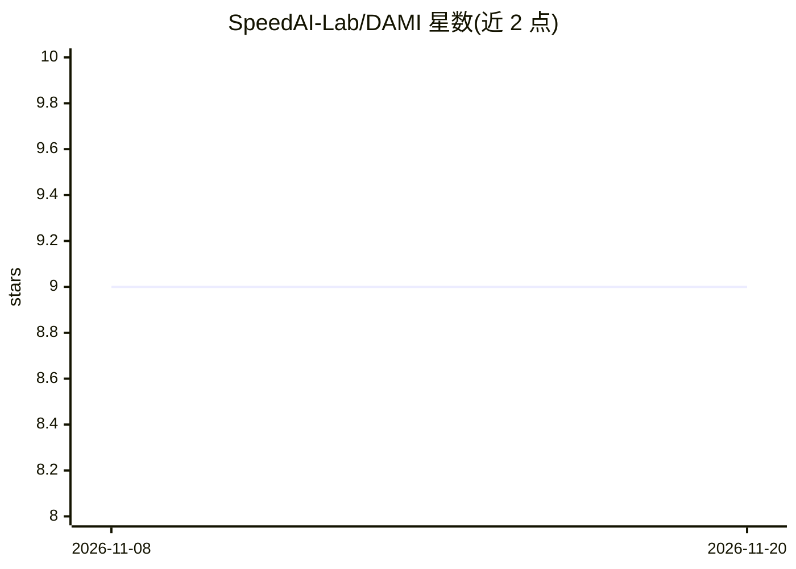

# SpeedAI-Lab/DAMI

⭐ 9 · Python · MIT · 推送 2026-11-03 · [GitHub](https://github.com/SpeedAI-Lab/DAMI) · [官网](https://speedai.com/research/dami) · 组织维护

**门控线性注意力的双轴记忆初始化方法与复现代码**

论文 DAMI 的官方代码仓库：在门控线性注意力（GDN/KDA/GDN2/Mamba-2/RWKV-7）中按头分配记忆时间尺度、按层分配输入响应，以改进长上下文检索。提供单一训练入口覆盖全部 15 种架构×初始化组合，附带 5,500 条固定评测样本、82,500 条原始预测与 15 个检查点的下载脚本（Hugging Face 权重需授权访问）。默认配置约 100M 参数、4096 上下文、5B token 训练量。

## 筛选速览

| 维度 | 判定 | 备注 |
|---|---|---|
| AI 角色 | `ai-native` | 本体是模型或模型工具 |
| 许可风险 | `permissive` | MIT |
| 部署形态 | `library` | 以包/库形式分发 |
| 模型依赖 | — | README 未给出锁定关系 |
| 硬件要求 | — | 无带数字的原话,不猜 |
| 安装摩擦 | `high` | 编译与系统依赖俱全 |
| 成熟度 | — | 结构信号不足 |

## 能力要点

- 一个训练入口支持 GDN/KDA/GDN2/Mamba-2/RWKV-7 与 Random/PoST/DAMI 共 15 种组合
- 附带固定评测样本与原始预测，重算可复现 165/165 个结果单元格
- 提供 --preflight/--rescore-reference 等无需 GPU 的检查与重算模式
- 检查点提供 SHA-256 完整性校验选项

## 适用场景

- 复现论文中五种线性注意力架构的长上下文检索实验
- 在自己的训练数据上比较不同初始化策略的效果
- 用 RULER 评测脚本重跑或核对已有检查点

## 场景标签

`模型评测` `模型训练` · 领域:评测与运维

## 证据(README 行号)

> L16: DAMI allocates memory timescalesacross heads and input responses across layers to improve long-context retrieval. T
> L8: Zhangchi Feng · Harry Jiang · Yangyifei Luo · Ray Zhang · Richong Zhang
> L153: Original repository code is released under the MIT License. Benchmark data retains its original attribution and ap

## 星数曲线

2026-11-08 9 → 2026-11-20 9（+0）

---
*卡片 v1 · prompt 1.4 · 生成 2026-11-20 · 置信度 high · 依据 README sha `de69b94176cb` · [字段定义](../../DATASET.md)*
