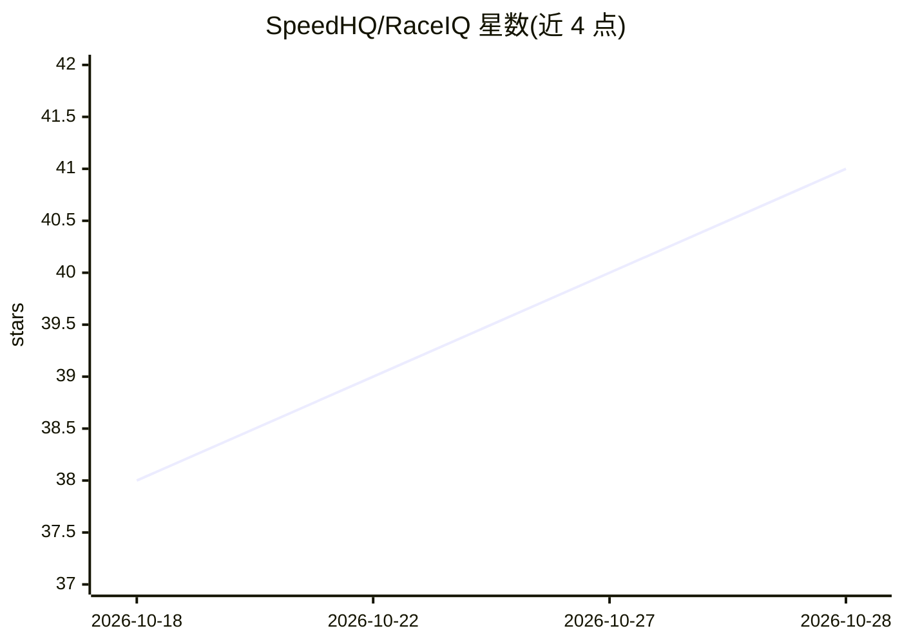

# SpeedHQ/RaceIQ

⭐ 41 · TypeScript · AGPL-3.0 · 推送 2026-10-27 · [GitHub](https://github.com/SpeedHQ/RaceIQ) · 个人维护

**模拟赛车遥测与单圈分析桌面应用（含可选 AI 教练）**

面向模拟赛车玩家的 Windows 伴侣应用：通过 UDP 或 Windows 原生共享内存从 Forza、F1 25、ACC、AC Evo、iRacing、LMU 等游戏读取遥测数据，提供实时仪表盘、单圈录制（SQLite 本地存储）、圈速对比、3D 回放、调校目录与社区调校分析，数据全部留在本机。AI 部分为可选功能：驾车技术反馈与分析，支持配置多家 API key 或按指南跑本地模型，README 自述为 Alpha 阶段。

## 筛选速览

| 维度 | 判定 | 备注 |
|---|---|---|
| AI 角色 | `ai-enhanced` | 去掉 AI 部分产品仍成立 |
| 许可风险 | `dual` | AGPL-3.0 |
| 部署形态 | `desktop` | 安装包/桌面程序 |
| 模型依赖 | — | README 未给出锁定关系 |
| 硬件要求 | — | 无带数字的原话,不猜 |
| 安装摩擦 | `low` | 无编译、无系统依赖或容器化 |
| 成熟度 | `idea` | |

## 能力要点

- UDP/共享内存读取多款模拟赛车遥测并实时展示
- 单圈录制、对比分析、3D 回放与赛道指南
- 车辆与调校目录，含社区调校范围分析
- AI 教练可选，支持多 provider 或本地模型

## 适用场景

- 查看实时遥测并复盘每圈的时间得失
- 对比自己的圈速或社区快车调校
- 获得 AI 驾驶技术反馈与改进建议

## 场景标签

`数据分析` · 领域:效率与自动化

## 证据(README 行号)

> L21: It captures telemetry from your racing games, provides a live dashboard, records every lap to a local database, and
> L31: - **AI coaching and chats** — get feedback on driving technique, setups, tires, and long-term improvement, with sav
> L109: AI analysis is optional. Add your API key in the RaceIQ settings panel — multiple providers are supported. Analysi

## 星数曲线

2026-10-18 38 → 2026-10-28 41（+3）

---
*卡片 v1 · prompt 1.4 · 生成 2026-10-25 · 置信度 high · 依据 README sha `9e28a50e2d05` · [字段定义](../../DATASET.md)*
