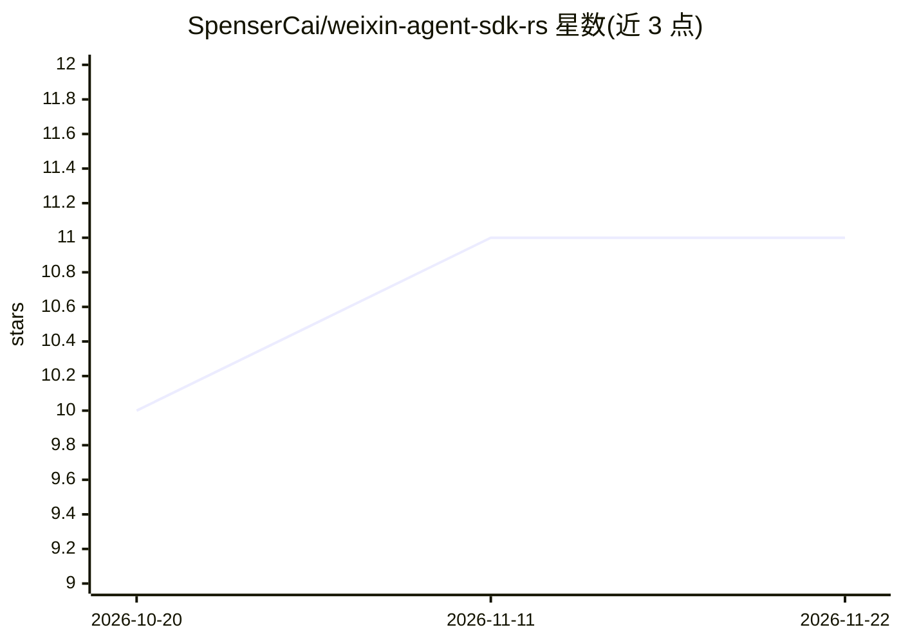

# SpenserCai/weixin-agent-sdk-rs

⭐ 11 · Rust · MIT · 推送 2026-08-13 · [GitHub](https://github.com/SpenserCai/weixin-agent-sdk-rs) · [官网](https://crates.io/crates/weixin-agent) · 个人维护 · 中文 README

**给开发者的微信 ClawBot 接入 Rust 协议层 SDK**

微信 iLink AI Bot 协议的 Rust SDK，对 @tencent-weixin/openclaw-weixin v2.4.6 做协议层等价移植，纯协议实现、不耦合 OpenClaw 插件框架。封装 iLink Bot API 全端点、长轮询消息循环（退避重连、Token 失效处理）、CDN 文件 AES 加解密上传下载、QR 码登录 API 与出站 Markdown 过滤。状态持久化、权限白名单、斜杠命令等应用层职责由调用方实现，以 Rust crate（git 依赖）形式提供，面向要为微信 ClawBot 构建自定义 Agent 的 Rust 开发者。

## 筛选速览

| 维度 | 判定 | 备注 |
|---|---|---|
| AI 角色 | `ai-ecosystem` | LLM/agent 周边工具 |
| 许可风险 | `permissive` | MIT |
| 部署形态 | `library` | 以包/库形式分发 |
| 模型依赖 | — | README 未给出锁定关系 |
| 硬件要求 | — | 无带数字的原话,不猜 |
| 安装摩擦 | `low` | 无编译、无系统依赖或容器化 |
| 成熟度 | — | 结构信号不足 |

## 能力要点

- iLink Bot API 全端点封装与长轮询消息循环（自动退避重连、Token 失效回调）
- CDN 文件上传/下载含 AES-128-ECB 加解密与自动重试
- QR 码登录 API 封装（含配对码验证流程）与出站 run_id 关联
- 协议向前兼容：入站枚举保留未知 wire 值

## 适用场景

- 为自己的 AI Agent 提供微信 ClawBot 消息收发通道
- 用 Rust 实现微信 bot 的文本/图片/视频/文件/语音消息处理
- 基于纯协议层构建不依赖 OpenClaw 宿主的独立 bot 应用

## 场景标签

 · 领域:开发工具/SDK

## 证据(README 行号)

> L8: 微信 iLink AI Bot 协议的 Rust SDK 实现，基于 `@tencent-weixin/openclaw-weixin` v2.4.6 协议层等价移植。
> L10: 本 SDK 是纯协议层实现，**不耦合 OpenClaw**，可用于自定义 Agent 接入微信 ClawBot 使用。

## 星数曲线

2026-10-20 10 → 2026-11-22 11（+1）

---
*卡片 v1 · prompt 1.4 · 生成 2026-11-18 · 置信度 high · 依据 README sha `1c22757c9fca` · [字段定义](../../DATASET.md)*
