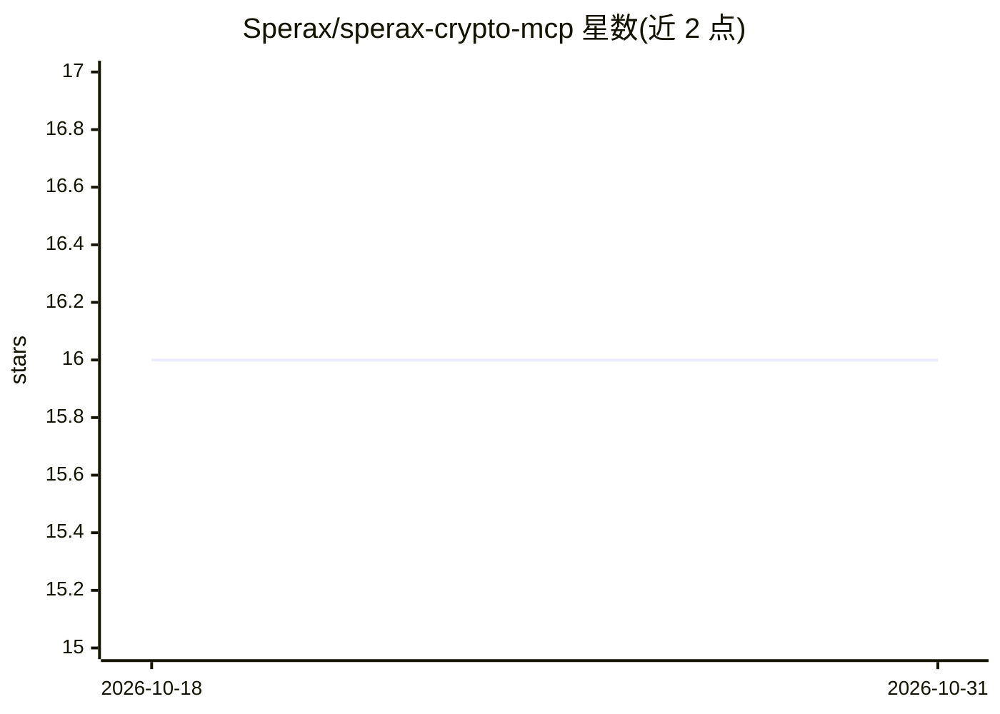

# Sperax/sperax-crypto-mcp

⭐ 16 · TypeScript · MIT · 推送 2026-09-20 · [GitHub](https://github.com/Sperax/sperax-crypto-mcp) · 组织维护

**Sperax DeFi 生态的 MCP 服务器：让 AI agent 查询链上协议数据**

面向 Sperax 协议（Arbitrum/BNB Chain/Ethereum）的 Model Context Protocol 服务器与插件，使 Claude Desktop、Cursor 等 AI agent 能查询 USDs 稳定币、SPA/veSPA/xSPA 质押、Demeter 收益农场、Vault 抵押、预言机价格与治理提案等数据。提供 57 个工具与 11 个文档资源，支持 stdio 与 HTTP 两种运行模式及自定义 RPC 端点。以 Node.js 18+ 源码方式构建运行，收录于 Anthropic 官方 MCP Registry。

## 筛选速览

| 维度 | 判定 | 备注 |
|---|---|---|
| AI 角色 | `ai-ecosystem` | LLM/agent 周边工具 |
| 许可风险 | `permissive` | MIT |
| 部署形态 | `None` |  |
| 模型依赖 | locked-api |  |
| 硬件要求 | — | 无带数字的原话,不猜 |
| 安装摩擦 | `medium` | 含编译或系统依赖之一 |
| 成熟度 | — | 结构信号不足 |

## 能力要点

- 57 个工具覆盖 USDs/Vault/SPA 质押/Demeter 农场/预言机/治理等 8 类查询
- 支持 stdio（Claude Desktop/Cursor/VS Code）与 HTTP 服务器两种模式
- 提供 11 个协议文档资源与 15 个示例 Prompt
- 支持自定义 Arbitrum RPC 端点

## 适用场景

- 在 Claude Desktop 中查询 USDs 余额、APY 与收益估算
- 让 AI agent 比较 Demeter 农场 APR 并计算质押投票权
- 获取 Sperax 协议健康度与治理提案概况

## 场景标签

`金融量化` · 领域:学习与行业

## 证据(README 行号)

> L3:  Model Context Protocol Server for Sperax DeFi Ecosystem
> L9:  Enable AI agents to interact with USDs (auto-yield stablecoin), SPA governance, veSPA staking, and Demeter yield fa
> L57: ### Claude Desktop

## 星数曲线

2026-10-18 16 → 2026-10-31 16（+0）

---
*卡片 v1 · prompt 1.4 · 生成 2026-10-30 · 置信度 high · 依据 README sha `9ab65e185606` · [字段定义](../../DATASET.md)*
