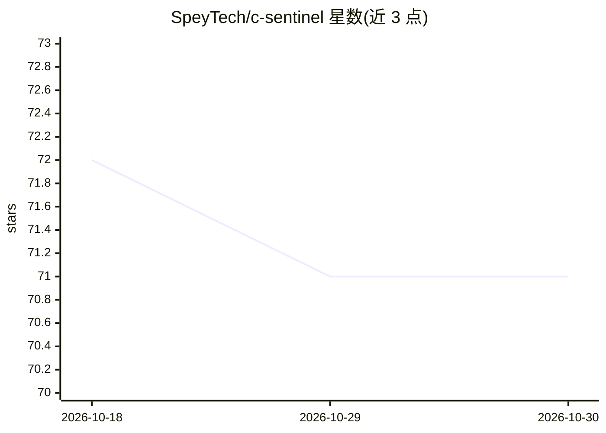

# SpeyTech/c-sentinel

⭐ 71 · C · MIT · 推送 2026-03-28 · [GitHub](https://github.com/SpeyTech/c-sentinel) · [官网](https://speytech.com/) · 个人维护

**C 编写的 UNIX 系统指纹采集器，供 AI 辅助安全分析**

轻量级 C 语言系统探针，采集主机、进程、配置、网络与 auditd 安全事件的“系统指纹”，以 JSON 输出供 LLM 分析与仪表盘消费；提供可解释的风险评分、基线学习与偏差检测、暴力破解/敏感文件访问/恶意软件指标等安全标记。附带多用户 RBAC Web 仪表盘（TOTP 双因素、个人 API Key、审计日志、会话管理）与 Email/Slack 告警。编译为约 99KB 静态二进制，可运行于任意 POSIX 系统；audit 探测需 root。

## 筛选速览

| 维度 | 判定 | 备注 |
|---|---|---|
| AI 角色 | `ai-enhanced` | 去掉 AI 部分产品仍成立 |
| 许可风险 | `permissive` | MIT |
| 部署形态 | `None` |  |
| 模型依赖 | — | README 未给出锁定关系 |
| 硬件要求 | — | 无带数字的原话,不猜 |
| 安装摩擦 | `medium` | 含编译或系统依赖之一 |
| 成熟度 | — | 结构信号不足 |

## 能力要点

- 采集系统/进程/配置/网络/安全五类指纹并以 JSON 输出供 LLM 与仪表盘使用
- 可解释风险评分（各因子加权）与基线学习/偏差检测
- auditd 集成：暴力破解、敏感文件访问、/tmp 与 /dev/shm 执行等安全标记
- 多用户 RBAC Web 仪表盘：TOTP 双因素、个人 API Key、审计日志、会话管理

## 适用场景

- 在服务器上持续监控安全事件并接收 Email/Slack 告警
- 把系统指纹 JSON 交给 LLM 做因果推理与安全分析
- 在 CI/CD 中用退出码（0-3）作为安全检查门槛

## 场景标签

`网络安全` · 领域:学习与行业

## 证据(README 行号)

> L5: A lightweight, portable system prober written in C that captures "system fingerprints" for AI-assisted analysis of n
> L72: C-Sentinel takes a different approach: capture a comprehensive system fingerprint—including security events—and use

## 星数曲线

2026-10-18 72 → 2026-10-30 71（-1）

---
*卡片 v1 · prompt 1.4 · 生成 2026-10-24 · 置信度 high · 依据 README sha `c0ce50a89f60` · [字段定义](../../DATASET.md)*
