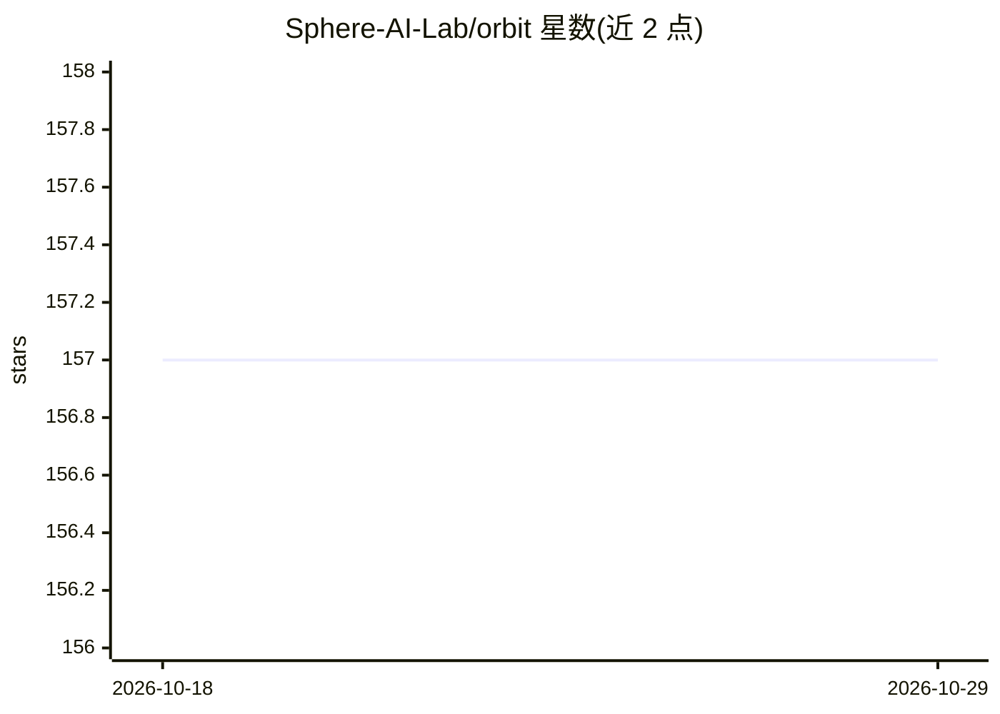

# Sphere-AI-Lab/orbit

⭐ 157 · Python · Apache-2.0 · 推送 2026-09-10 · [GitHub](https://github.com/Sphere-AI-Lab/orbit) · [官网](https://spherelab.ai/orbit/) · 组织维护

**面向万亿参数 LLM 的单节点低精度 RL 后训练框架**

Orbit 是一个轻量级大规模强化学习后训练框架：将基座模型保持在部署精度（INT4/NVFP4/FP8/BF16）并冻结，梯度只落在小型 BF16 OFT/LoRA 适配器上，声称可在单个 8×B200 节点上完成 1T 级模型的 RL 后训练，训练与推 rolled out 使用相同核与量化方案以消除精度差距。已用于 Kimi-K2.6（约1T）、DeepSeek V4-Flash、DeepSeek V4-Pro（约1.6T）及 Qwen3 MoE 系列。安装要求 Python 3.12、CUDA 13.2、PyTorch 2.11，需相邻目录放置 Megatron-Bridge、Megatron-LM、sglang 后端检出，首次 uv sync 从源码构建整栈约需 1-2 小时；适配器支持 PEFT KL 在模型内计算参考 log-prob，无需独立参考 worker。

## 筛选速览

| 维度 | 判定 | 备注 |
|---|---|---|
| AI 角色 | `ai-ecosystem` | LLM/agent 周边工具 |
| 许可风险 | `permissive` | Apache-2.0 |
| 部署形态 | `None` |  |
| 模型依赖 | — | README 未给出锁定关系 |
| 硬件要求 | — | 无带数字的原话,不猜 |
| 安装摩擦 | `medium` | 含编译或系统依赖之一 |
| 成熟度 | — | 结构信号不足 |

## 能力要点

- 冻结低精度基座 + BF16 OFT/LoRA 适配器的 RL 后训练
- 单 8×B200 节点运行 1T 级模型，无需跨节点编排
- INT4/NVFP4/FP8/BF16 一级支持，Megatron 与 SGLang 间有一致性预检门
- 异步适配器双缓冲与 PEFT KL 在模型内计算参考 log-prob

## 适用场景

- 在单节点上对超大 MoE 模型做 RL 后训练
- 低精度（FP8/FP4）模型保持部署精度同时训练适配器
- 通过 examples/ 下的 bash 配方快速启动 RL 训练与冒烟测试

## 场景标签

`强化学习` `微调` · 领域:训练与推理

## 证据(README 行号)

> L3:  A lightweight, ultra-scale RL post-training framework built around low-precision bases and BF16 adapters &mdash; so
> L10: Today's leading LLMs cross the trillion-parameter mark, and the conventional RL post-training recipe demands high-p
> L21: |🧩|**PEFT-native**|LoRA and OFT adapters; PEFT KL launchers compute reference log-probs in-model (no separate refer

## 星数曲线

2026-10-18 157 → 2026-10-29 157（+0）

---
*卡片 v1 · prompt 1.4 · 生成 2026-10-22 · 置信度 high · 依据 README sha `1ac91cb48da3` · [字段定义](../../DATASET.md)*
