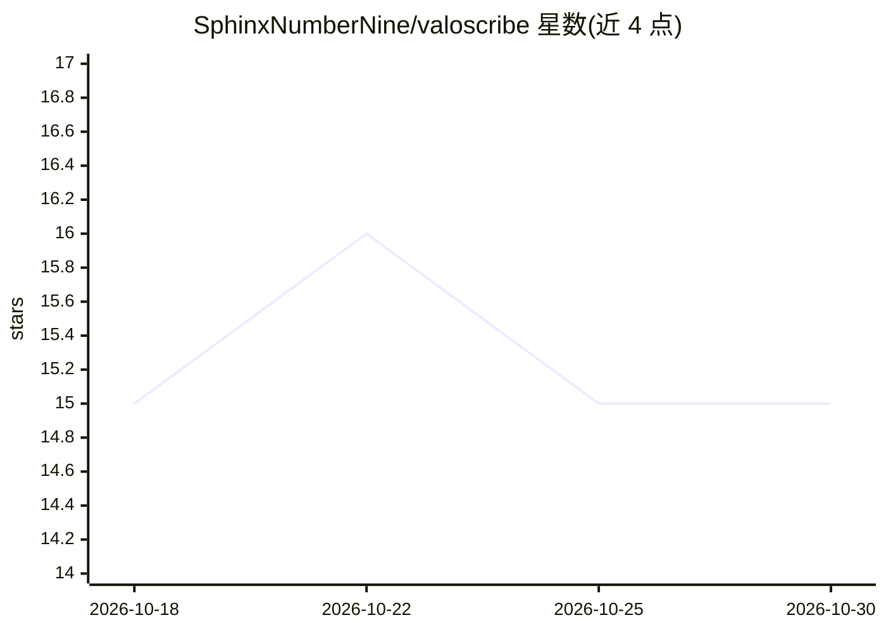

# SphinxNumberNine/valoscribe

⭐ 15 · Python · MIT · 推送 2026-10-15 · [GitHub](https://github.com/SphinxNumberNine/valoscribe) · 个人维护

**用计算机视觉与 OCR 从 Valorant 比赛视频提取结构化事件与选手状态**

面向电竞分析与机器学习的 VOD 解析工具：输入 VLR.gg 比赛 URL，自动抓取赛事元数据、下载 YouTube 视频，通过模板匹配与 OCR 解析职业转播的观战 HUD，输出带时间戳的事件日志（击杀/技能/回合/下包）与逐帧选手状态（血量、护甲、技能、经济）。支持多场比赛并行批处理与事件校验。限制：仅支持 1080p 观战视角 HUD，处理一场约需 1.5-3 小时，HUD 坐标配置绑定特定转播版式，个别英雄（Astra/Neon/Chamber/Jett/Viper）技能事件存在已知偏差。

## 筛选速览

| 维度 | 判定 | 备注 |
|---|---|---|
| AI 角色 | `ai-native` | 本体是模型或模型工具 |
| 许可风险 | `permissive` | MIT |
| 部署形态 | `None` |  |
| 模型依赖 | — | README 未给出锁定关系 |
| 硬件要求 | — | 无带数字的原话,不猜 |
| 安装摩擦 | `low` | 无编译、无系统依赖或容器化 |
| 成熟度 | — | 结构信号不足 |

## 能力要点

- VLR.gg URL 一键流程：抓元数据→下载 VOD→生成事件日志与帧状态
- OCR+模板匹配解析观战 HUD，逐帧追踪 10 名选手状态
- 多条件状态校验抑制误报，事件推断补全提前结束的回合
- 并行批处理与输出质量校验脚本

## 适用场景

- 分析职业比赛的技能使用与经济决策
- 基于事件数据自动剪辑击杀与关键时刻
- 为胜率预测、选手表现模型构建训练数据
- 逐帧复盘复盘选手状态与技能冷却

## 场景标签

`OCR` · 领域:感知与多模态

## 证据(README 行号)

> L5: Valoscribe uses computer vision and OCR to convert Valorant esports VODs into structured data, enabling analytics, h
> L29: - **Fully Automated** - Provide a VLR.gg match URL, get structured event logs and frame states

## 星数曲线

2026-10-18 15 → 2026-10-30 15（+0）

---
*卡片 v1 · prompt 1.4 · 生成 2026-10-30 · 置信度 high · 依据 README sha `f5ccc8479e85` · [字段定义](../../DATASET.md)*
