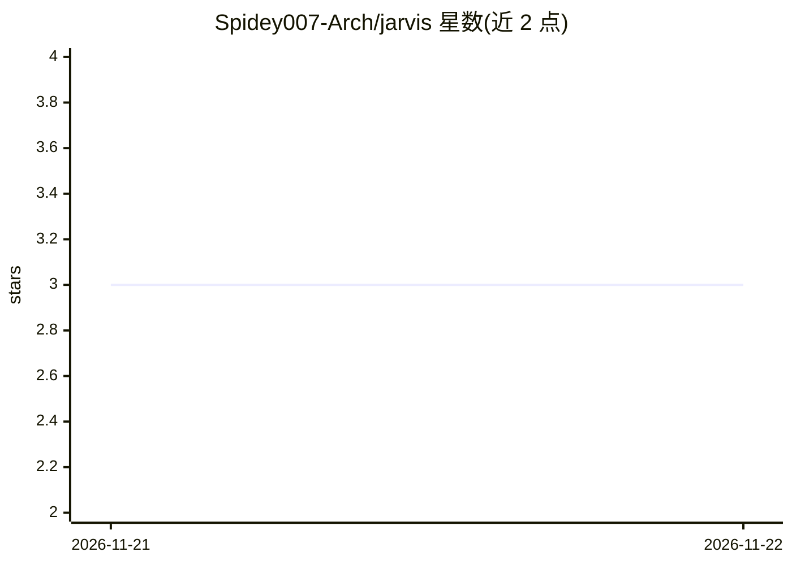

# Spidey007-Arch/jarvis

⭐ 3 · Python · MIT · 推送 2026-11-20 · [GitHub](https://github.com/Spidey007-Arch/jarvis) · 个人维护

**Windows 个人 AI 桌面助手：对话、操作电脑、定时任务**

运行于 Windows 10/11 的个人 AI 助手，由四个本地程序组成：Tauri 桌面壳、FastAPI 后端、执行 Windows 操作的 agent、React 界面。支持语音对话（Gemini Live 或本地离线语音）、读写文件、运行命令、控制屏幕与浏览器、读取文档与邮件、长期记忆、定时自动化与 MCP 连接器。自带 AI 密钥（bring your own AI），按动作粒度设置权限。当前需从源码运行，尚无安装包。

## 筛选速览

| 维度 | 判定 | 备注 |
|---|---|---|
| AI 角色 | `ai-native` | 本体是模型或模型工具 |
| 许可风险 | `permissive` | MIT |
| 部署形态 | `desktop` | 安装包/桌面程序 |
| 模型依赖 | local-ok | 支持本地模型 |
| 硬件要求 | — | 无带数字的原话,不猜 |
| 安装摩擦 | `low` | 无编译、无系统依赖或容器化 |
| 成熟度 | `idea` | |

## 能力要点

- 语音与文字对话，支持 Gemini Live 与离线语音（openWakeWord/Parakeet/Whisper/Piper）
- 通过 Windows UI Automation 打开应用、运行命令、编辑文件、操作屏幕
- 长期记忆面板、加密备份与多 PC 同步（无服务器）
- 自动模型切换、提示缓存、本地 AI 网关 OmniRoute 备援

## 适用场景

- 用语音让助手代为操作 Windows 应用、文件与终端
- 让助手按计划定时检查邮件、日历和系统状态并汇报
- 让助手跨网页与本地文档做多来源研究并给出引用
- 通过 MCP 连接器把 Slack/GitHub/Notion 等接入为工具

## 场景标签

`AI 助手` · 领域:对话与助手

## 证据(README 行号)

> L3: **A personal AI assistant that lives on your Windows PC, modelled on JARVIS from the Iron Man films.**
> L155:  automations and permissions, talks to your chosen AI, and runs the agent loop: the AI proposes a tool call, the

## 星数曲线

2026-11-21 3 → 2026-11-22 3（+0）

---
*卡片 v1 · prompt 1.4 · 生成 2026-11-22 · 置信度 mid · 依据 README sha `19a73ec367c6` · [字段定义](../../DATASET.md)*
