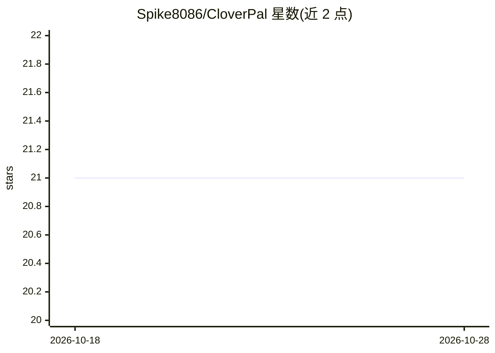

# Spike8086/CloverPal

⭐ 21 · HTML · AGPL-3.0 · 推送 2026-10-01 · [GitHub](https://github.com/Spike8086/CloverPal) · 个人维护 · 中文 README

**安卓全离线 LLM 客户端，支持多角色角色扮演与语音输入**

面向安卓用户的本地 LLM 聊天客户端，内嵌基于 llama.cpp（ARMv8.4 DotProd 优化）的推理引擎，加载 GGUF 模型后提供对话、文档解析（txt/docx/pdf 入上下文）、LaTeX 渲染、HTML 沙箱预览，以及离线 Silly Tavern 模式：创建带头像和系统提示词的角色，在群聊中让 2–3 个 AI 角色互相对话。语音转文字由 whisper.cpp 离线完成，支持 99 种语言自动检测。模型可从 HuggingFace / ModelScope 一键下载或本地导入，数据不出设备；iOS 版标注 Coming Soon。

## 筛选速览

| 维度 | 判定 | 备注 |
|---|---|---|
| AI 角色 | `ai-native` | 本体是模型或模型工具 |
| 许可风险 | `viral` | AGPL-3.0 |
| 部署形态 | `None` |  |
| 模型依赖 | local-ok | 支持本地模型 |
| 硬件要求 | — | 无带数字的原话,不猜 |
| 安装摩擦 | `low` | 无编译、无系统依赖或容器化 |
| 成熟度 | — | 结构信号不足 |

## 能力要点

- 离线 Silly Tavern 模式：2–3 个自定义 AI 角色群聊互谈
- whisper.cpp 离线语音识别，99 种语言自动检测
- 文档解析（txt/docx/pdf）、LaTeX 渲染、HTML 沙箱预览
- HuggingFace / ModelScope 一键下载模型与 GGUF 直接读取

## 适用场景

- 在安卓手机上完全离线地与本地 LLM 对话或角色扮演
- 把 txt/docx/pdf 文档读入聊天上下文进行问答
- 让多个自定义 AI 角色在群聊中互动生成剧情

## 场景标签

`聊天机器人` `语音识别` · 领域:对话与助手

## 证据(README 行号)

> L10: CloverPal is a hardcore, fully **offline** LLM client for Android. Powered by deeply optimized llama.cpp (ARMv8.4 D
> L24: - **Speech Recognition** — Offline voice-to-text powered by whisper.cpp, supporting automatic language detection ac

## 星数曲线

2026-10-18 21 → 2026-10-28 21（+0）

---
*卡片 v1 · prompt 1.4 · 生成 2026-10-28 · 置信度 high · 依据 README sha `8654ded64a51` · [字段定义](../../DATASET.md)*
