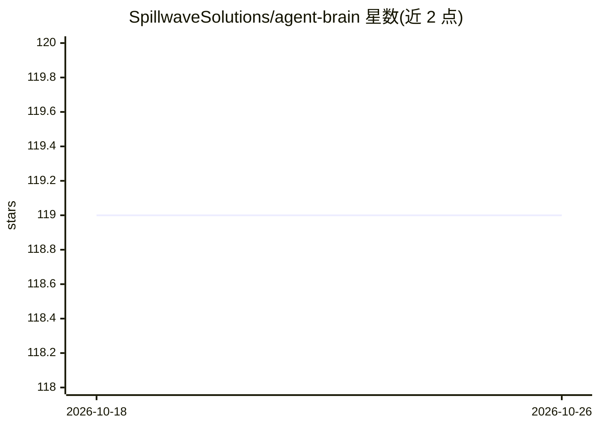

# SpillwaveSolutions/agent-brain

⭐ 119 · Python · MIT · 推送 2026-09-19 · [GitHub](https://github.com/SpillwaveSolutions/agent-brain) · [官网](https://github.com/SpillwaveSolutions/agent-brain/wiki) · 组织维护

**面向 AI agent 的本地 RAG 文档/代码索引检索系统**

Agent Brain 是为 AI agent 与应用提供的 RAG 文档与源码索引及语义检索系统：FastAPI 后端负责索引与检索，提供 5 种检索模式（向量/BM25/混合/知识图谱/RRF 多模式），支持 tree-sitter AST 感知分块索引 10 种编程语言，嵌入与摘要可插拔选择 OpenAI/Ollama/Cohere/Anthropic 等，可通过 Ollama 实现完全本地离线运行。主接口为 Claude Code 插件（30 个斜杠命令、3 个 agent、2 个 skill），也可通过 CLI 安装到 Codex/Cursor/Grok/OpenCode 等宿主，并提供带 OAuth 2.1 的 MCP server（16 个工具）。

## 筛选速览

| 维度 | 判定 | 备注 |
|---|---|---|
| AI 角色 | `ai-ecosystem` | LLM/agent 周边工具 |
| 许可风险 | `permissive` | MIT |
| 部署形态 | `library` | 以包/库形式分发 |
| 模型依赖 | local-ok | 支持本地模型 |
| 硬件要求 | — | 无带数字的原话,不猜 |
| 安装摩擦 | `low` | 无编译、无系统依赖或容器化 |
| 成熟度 | — | 结构信号不足 |

## 能力要点

- 向量/BM25/混合/GraphRAG/RRF 五种检索模式
- tree-sitter AST 感知分块，索引 10 种编程语言
- 嵌入与摘要 provider 可插拔，支持 Ollama 完全本地模式
- Claude Code 插件 + MCP server（16 工具、OAuth 2.1）双接入方式

## 适用场景

- 在 Claude Code 里用自然语言检索项目文档和代码
- 让 agent 回答代码依赖与架构问题（GraphRAG 查询）
- 多项目隔离地搭建本地文档知识库供 agent 检索

## 场景标签

`RAG` `语义搜索` `知识图谱` · 领域:知识与检索

## 证据(README 行号)

> L5: A RAG-based (Retrieval-Augmented Generation) document indexing and semantic search system for AI agents and applicat
> L16: |**Server**|FastAPI backend for indexing and retrieval|

## 星数曲线

2026-10-18 119 → 2026-10-26 119（+0）

---
*卡片 v1 · prompt 1.4 · 生成 2026-10-23 · 置信度 high · 依据 README sha `473c3129e1f0` · [字段定义](../../DATASET.md)*
