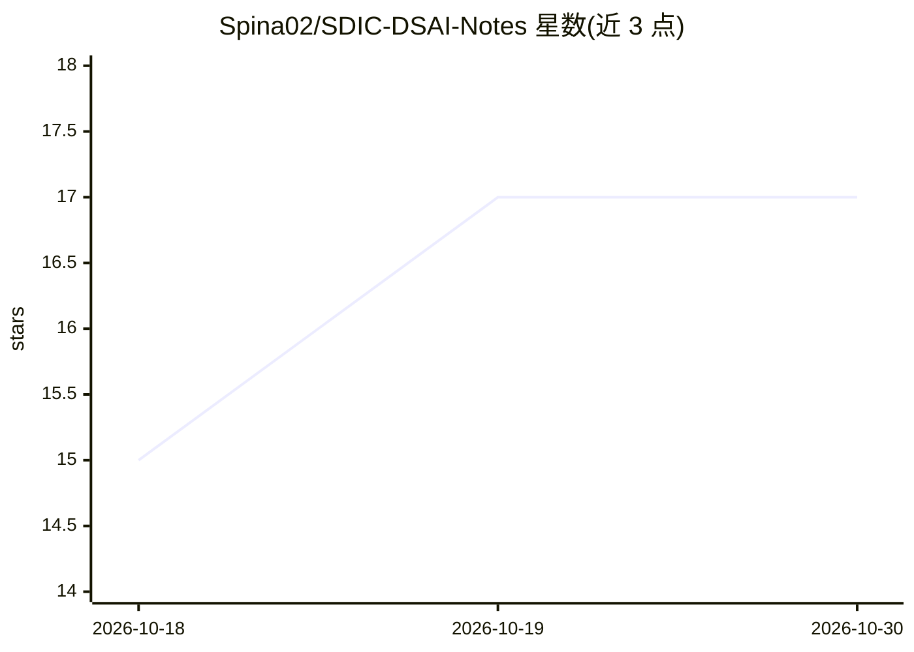

# Spina02/SDIC-DSAI-Notes

⭐ 17 · TeX · 推送 2026-10-26 · [GitHub](https://github.com/Spina02/SDIC-DSAI-Notes) · 个人维护

**的里雅斯特大学 SDIC/DSAI 课程 LaTeX 笔记汇编（PDF）**

收录 Università degli Studi di Trieste 数据科学与人工智能（SDIC/DSAI）课程 2024/2026 学年的 LaTeX 学习笔记，部分内容来自 Christian 在阿利坎特大学 Erasmus 交换期间的课程。课程覆盖机器学习、强化学习、概率机器学习、深度学习、自然语言处理、计算机视觉、云计算与高性能计算、天体物理学等，README 以表格列出各门课 PDF 链接及完成状态（DONE/WIP/REV）。以学习资料形式提供，不含可安装运行的软件。

## 筛选速览

| 维度 | 判定 | 备注 |
|---|---|---|
| AI 角色 | `ai-knowledge` | 知识聚合/清单类 |
| 许可风险 | `none` | — |
| 部署形态 | `None` |  |
| 模型依赖 | — | README 未给出锁定关系 |
| 硬件要求 | — | 无带数字的原话,不猜 |
| 安装摩擦 | `low` | 无编译、无系统依赖或容器化 |
| 成熟度 | — | 结构信号不足 |

## 能力要点

- 覆盖 ML/RL/NLP/CV/HPC 等约 20 门课程的 LaTeX 笔记
- 每门课提供 PDF 链接与编写状态标记（DONE/WIP/REV）
- 部分材料来自西班牙阿利坎特大学 Erasmus 交换课程

## 适用场景

- 查找数据科学与 AI 硕士课程的复习笔记
- 参考机器学习、深度学习、NLP 等主题的系统化整理
- 对照意大利 UniTS 与西班牙交换课程的教学内容

## 场景标签

`教程课程` · 领域:学习与行业

## 证据(README 行号)

> L25:  Introduction to Machine Learning
> L65:  Natural Language Processing

## 星数曲线

2026-10-18 15 → 2026-10-30 17（+2）

---
*卡片 v1 · prompt 1.4 · 生成 2026-10-29 · 置信度 high · 依据 README sha `9995d0685d61` · [字段定义](../../DATASET.md)*
