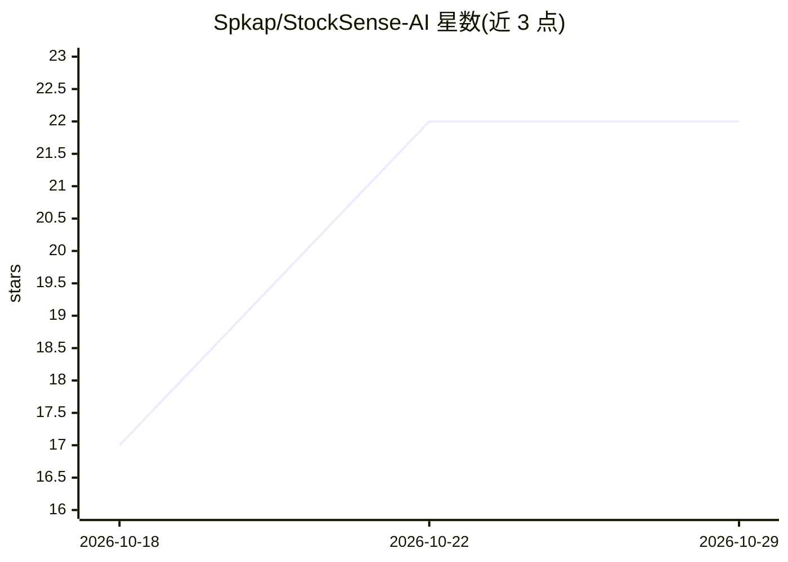

# Spkap/StockSense-AI

⭐ 22 · Python · MIT · 推送 2026-10-27 · [GitHub](https://github.com/Spkap/StockSense-AI) · 个人维护

**多智能体股票研究系统：牛熊辩论生成概率加权结论**

自主股票分析系统，实现 ReAct 推理模式：基于 LangGraph 的 agent 迭代推理并调用新闻（NewsAPI）、历史价格（yfinance）、情绪分析工具，随后由 Bull、Bear、Skeptic 三个对立视角 agent 进行强制反驳辩论，Synthesizer 按数据支持度与反驳强度给每条声明打分，输出 Bull/Base/Bear 三情景概率加权结论。另含投资论点记录与 Kill Criteria 自动监控告警。后端 FastAPI，前端 React 19，Supabase 持久化，需 Google Gemini、NewsAPI 的 API key 与 Supabase 项目。声明仅供教育研究用途，非投资建议。

## 筛选速览

| 维度 | 判定 | 备注 |
|---|---|---|
| AI 角色 | `ai-native` | 本体是模型或模型工具 |
| 许可风险 | `permissive` | MIT |
| 部署形态 | `None` |  |
| 模型依赖 | — | README 未给出锁定关系 |
| 硬件要求 | — | 无带数字的原话,不猜 |
| 安装摩擦 | `low` | 无编译、无系统依赖或容器化 |
| 成熟度 | — | 结构信号不足 |

## 能力要点

- Bull/Bear/Skeptic 多 agent 对抗辩论与强制反驳轮
- 按数据支持度与反驳强度对声明进行证据评分
- 输出三情景概率加权结论而非买卖二元建议
- 投资论点 Kill Criteria 自动监控与告警

## 适用场景

- 输入股票代码获得多视角概率加权的研究分析
- 记录投资论点并自动监控失效条件
- 通过 SSE 实时观察 agent 推理过程

## 场景标签

`多智能体` `金融量化` · 领域:Agent 开发

## 证据(README 行号)

> L5: StockSense is an autonomous stock analysis system implementing the **ReAct (Reasoning + Action)** pattern: iterative
> L35: - **Multi-Agent Debate**: Bull, Bear, and Skeptic agents argue and challenge each other's claims

## 星数曲线

2026-10-18 17 → 2026-10-29 22（+5）

---
*卡片 v1 · prompt 1.4 · 生成 2026-10-27 · 置信度 high · 依据 README sha `ab793370eb55` · [字段定义](../../DATASET.md)*
