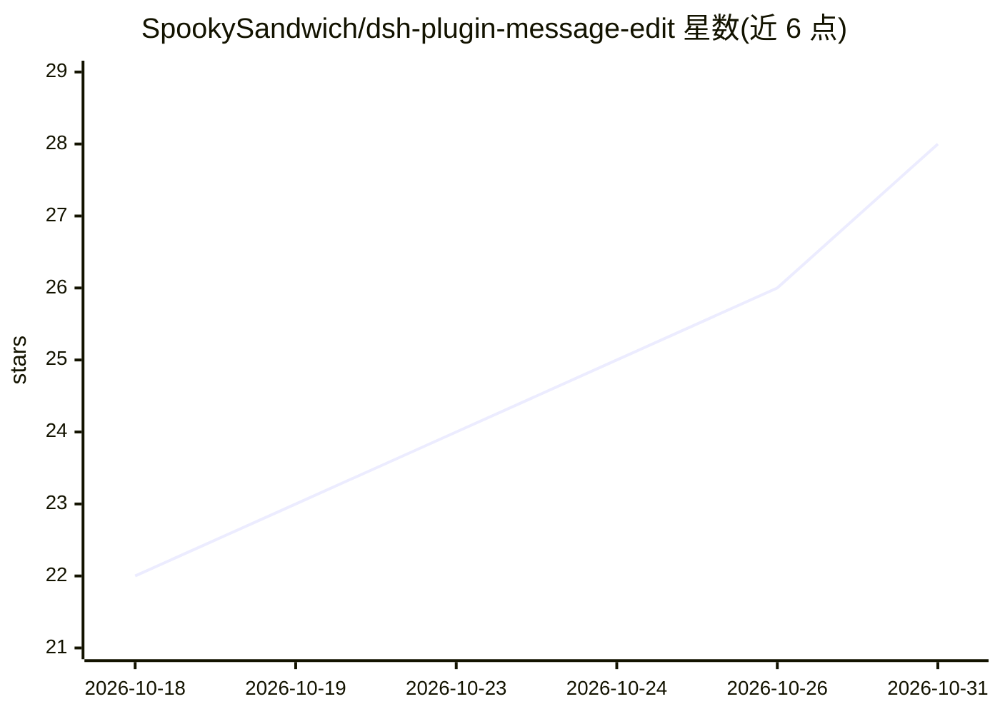

# SpookySandwich/dsh-plugin-message-edit

⭐ 28 · JavaScript · NOASSERTION · 推送 2026-10-30 · [GitHub](https://github.com/SpookySandwich/dsh-plugin-message-edit) · 个人维护 · 中文 README

**DSH 聊天界面的消息编辑与对话分叉插件**

面向 DSH（DeepSeek Harness）聊天客户端的插件：编辑已发送消息后，以目标轮次之前的全部事件为种子创建新会话，实现回溯式分叉而非末尾 fork。提供气泡下方 ‹n/m› 版本计数、可平移缩放的版本树标签页、ChatGPT/DeepSeek/Claude 三种按钮布局预设，以及重试、复制、自动中止旧分支流式生成等功能。版本关系以持久事件写入日志，重启后保留。通过 dsh plugin 命令安装，声明兼容范围 >=0.2.0-rc.2 <0.3.0-0。

## 筛选速览

| 维度 | 判定 | 备注 |
|---|---|---|
| AI 角色 | `ai-ecosystem` | LLM/agent 周边工具 |
| 许可风险 | `none` | NOASSERTION |
| 部署形态 | `None` |  |
| 模型依赖 | — | README 未给出锁定关系 |
| 硬件要求 | — | 无带数字的原话,不猜 |
| 安装摩擦 | `low` | 无编译、无系统依赖或容器化 |
| 成熟度 | — | 结构信号不足 |

## 能力要点

- 编辑消息以历史事件为种子创建新会话，实现真正回溯分叉
- ‹n/m› 版本计数与可视化版本树（当前分支高亮、点击跳转）
- ChatGPT/DeepSeek/Claude 三种界面布局预设
- 分叉时自动中止旧分支的流式生成，避免浪费 Token

## 适用场景

- 在 DSH 中修改已发送的提问并探索不同对话分支
- 可视化查看和切换深层分叉的版本树
- 按习惯选择 ChatGPT/DeepSeek/Claude 风格的操作按钮布局

## 场景标签

 · 领域:AI 聊天界面/插件

## 证据(README 行号)

> L57: - 宿主端提供 `/message-tree` 接口。编辑消息时，会 **以目标轮次之前的全部事件为种子创建一个新会话**，写入持久的 `message-tree/version` 标记说明改动内容，并把编辑后的提问送入。
> L48: dsh plugin --profile web add dsh-plugin-message-edit

## 星数曲线

2026-10-18 22 → 2026-10-31 28（+6）

---
*卡片 v1 · prompt 1.4 · 生成 2026-10-26 · 置信度 high · 依据 README sha `2603a0c84ba9` · [字段定义](../../DATASET.md)*
