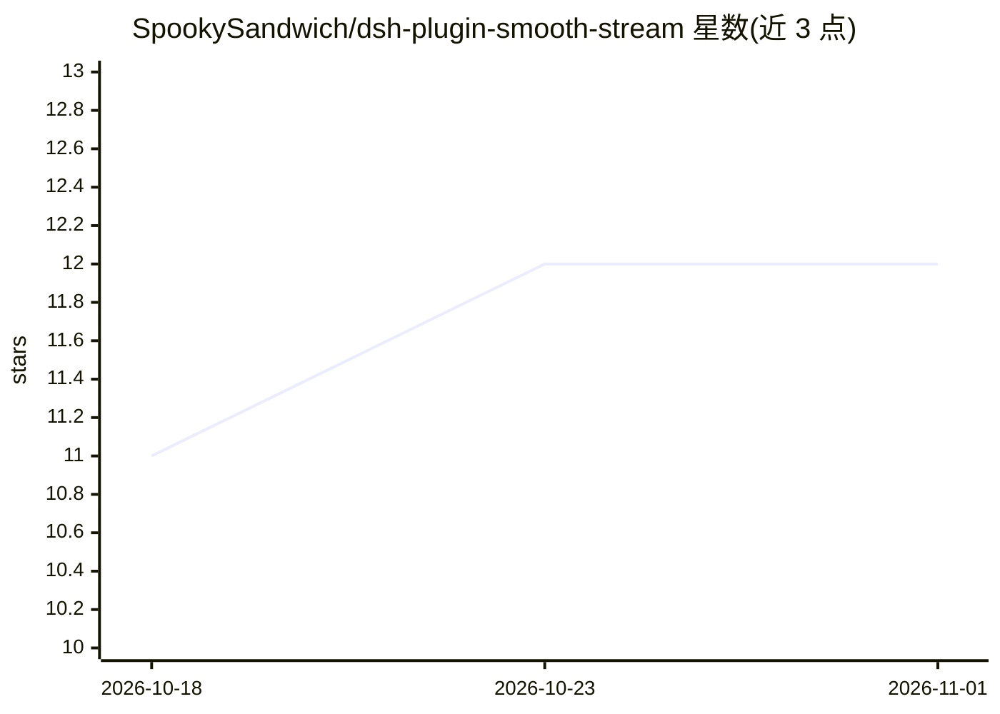

# SpookySandwich/dsh-plugin-smooth-stream

⭐ 12 · JavaScript · MIT · 推送 2026-10-30 · [GitHub](https://github.com/SpookySandwich/dsh-plugin-smooth-stream) · 个人维护 · 中文 README

**DeepSeek Harness 聊天客户端的流式渲染插件：段落分批淡入**

面向 DSH（DeepSeek Harness）聊天客户端的渲染插件：接管对话视图中助手消息的流式呈现，把逐字输出改为按段落攒批、整段入场动画（8 种可选），流式期间平滑跟随滚动，思考块显示实时单行摘要。正文沿用宿主自带 Markdown/KaTeX 渲染器，避开未完成的代码块与表格。提供设置面板（分批大小、动画时长等），支持 prefers-reduced-motion 自动关闭动画，渲染出错时降级纯文本。通过 dsh plugin 命令或 GitHub Release 包安装，与接管同槽位的其他渲染插件互斥。

## 筛选速览

| 维度 | 判定 | 备注 |
|---|---|---|
| AI 角色 | `ai-enhanced` | 去掉 AI 部分产品仍成立 |
| 许可风险 | `permissive` | MIT |
| 部署形态 | `None` |  |
| 模型依赖 | — | README 未给出锁定关系 |
| 硬件要求 | — | 无带数字的原话,不猜 |
| 安装摩擦 | `low` | 无编译、无系统依赖或容器化 |
| 成熟度 | — | 结构信号不足 |

## 能力要点

- 按段落分批呈现，8 种入场动画（120–1200 ms 可调）
- 流式期间平滑滚动跟随，上滚交还、回底自动继续
- 思考块实时单行摘要与签名信封格式适配
- 设置面板带实时预览，渲染出错自动降级纯文本

## 适用场景

- 阅读长回复时获得段落式、带动画的流式呈现
- 减少逐字流式输出带来的视觉抖动
- 在减少动态效果偏好下自动关闭动画

## 场景标签

`聊天机器人` · 领域:对话与助手

## 证据(README 行号)

> L12: 把逐字抖动的流式输出，换成按段落分批、淡入呈现的阅读体验。流式期间平滑跟随滚动，思考块显示实时单行摘要。
> L78: - 本插件接管对话视图的 assistant 消息渲染（`conversation.chat.node` 的 `assistant-step` 槽位），与其他同样接管该渲染的插件互斥——同装时只有一个生效。

## 星数曲线

2026-10-18 11 → 2026-11-01 12（+1）

---
*卡片 v1 · prompt 1.4 · 生成 2026-11-01 · 置信度 high · 依据 README sha `93e6c20e03ca` · [字段定义](../../DATASET.md)*
