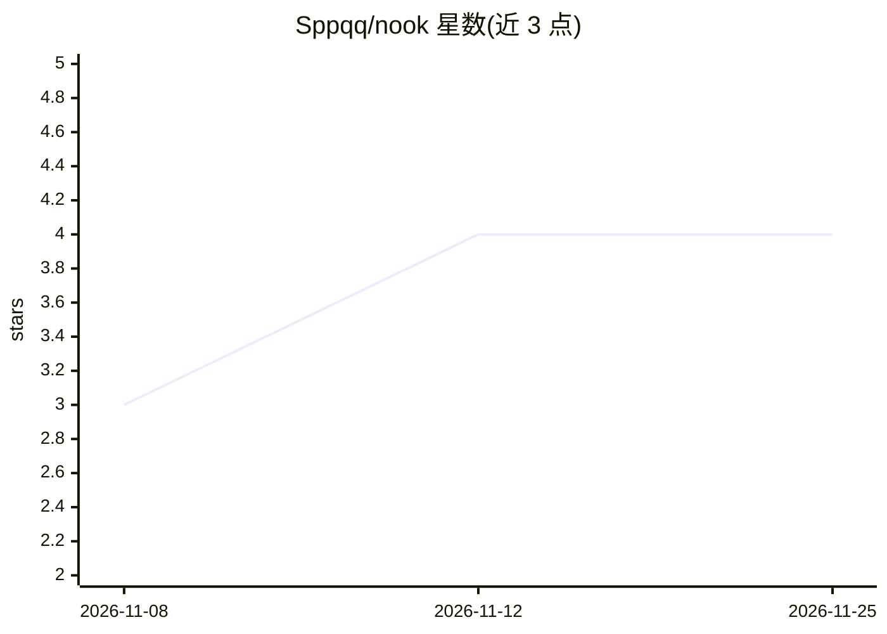

# Sppqq/nook

⭐ 4 · Python · MIT · 推送 2026-11-22 · [GitHub](https://github.com/Sppqq/nook) · 个人维护

**自托管 Telegram 服务器管理 AI 助手，可通过对话自我扩展**

Nook 是一个自托管的 Telegram 助手，运行于 Linux 服务器上，用于检查日志、排查故障服务、检查磁盘占用并执行维护任务。它通过 Codex CLI、Google Antigravity CLI 或 Mercury 运行任务，支持本地 Markdown 笔记、服务与资源监控、通过 SSH 管理其他服务器，以及 Python mods/skills 的热加载。当前版本为早期预览（0.1.1），Telegram 界面与安装向导为俄语；官方说明尚未在全新 VPS 上验证完整安装。需要用户自有 Telegram bot token 与 provider 账号。

## 筛选速览

| 维度 | 判定 | 备注 |
|---|---|---|
| AI 角色 | `ai-native` | 本体是模型或模型工具 |
| 许可风险 | `permissive` | MIT |
| 部署形态 | `None` |  |
| 模型依赖 | — | README 未给出锁定关系 |
| 硬件要求 | — | 无带数字的原话,不猜 |
| 安装摩擦 | `low` | 无编译、无系统依赖或容器化 |
| 成熟度 | `idea` | |

## 能力要点

- 在聊天中描述新能力，助手可自行编写并加载 Python mod，无需重启
- 通过 SSH 管理其他服务器，支持定时维护与消息互通的多实例配对
- 支持在线更新流程，保留配置并具备回滚与监督重启机制
- Mercury 可作为 Codex 配额耗尽时的备用模型

## 适用场景

- 在 Telegram 中查看并维护自己的 Linux 服务器
- 让助手根据对话描述自行实现新功能模块
- 集中管理多台服务器并接收健康检查告警

## 场景标签

`AI 助手` · 领域:对话与助手

## 证据(README 行号)

> L7: Nook is a self-hosted Telegram assistant that helps you look after a Linux server. Ask it to inspect logs, investiga
> L19: **Describe a capability in chat, and Nook can implement it in its own installation.** Add a menu button, connect a 
> L28: - Run tasks with Codex CLI, Google Antigravity CLI, or Mercury. Model availability depends on your provider account

## 星数曲线

2026-11-08 3 → 2026-11-25 4（+1）

---
*卡片 v1 · prompt 1.4 · 生成 2026-11-21 · 置信度 high · 依据 README sha `7d3aaf999bf8` · [字段定义](../../DATASET.md)*
