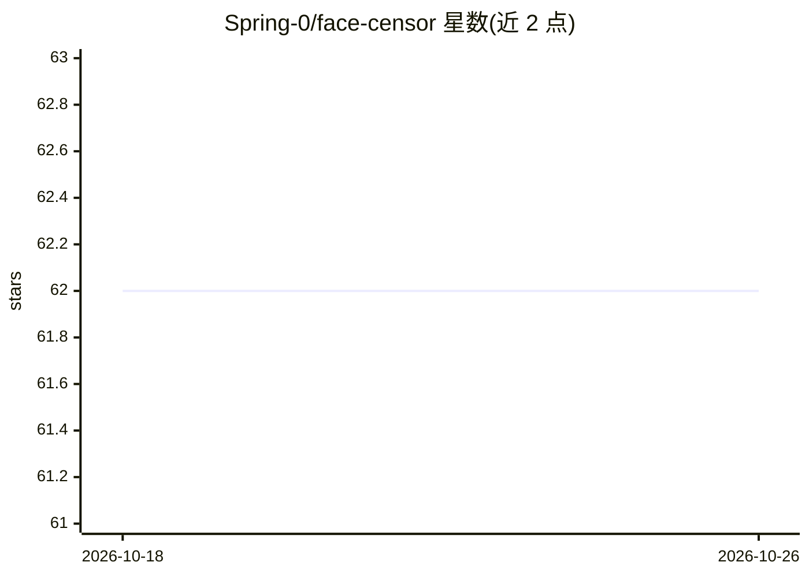

# Spring-0/face-censor

⭐ 62 · Python · GPL-3.0 · 推送 2026-05-26 · [GitHub](https://github.com/Spring-0/face-censor) · [官网](https://huggingface.co/spaces/Spring-0/face-censor) · 个人维护

**检测图像/视频中人脸并打码（模糊/表情/文字）的 Python 系统**

基于 YOLOv8（WIDER FACE 数据集经 Roboflow 训练）的人脸检测与遮挡系统，支持图像和视频处理。检测后可通过模块化的遮罩对象对人脸施加模糊、表情符号或文字三种遮挡效果，提供 API 用法（YOLOFaceDetector + MediaProcessor）和带 UI 的本地运行方式。提供 Docker 镜像和源码安装两种途径，附带可选的模型重训练脚本。实时流处理与局部人脸遮挡（眼部）为待实现功能。

## 筛选速览

| 维度 | 判定 | 备注 |
|---|---|---|
| AI 角色 | `ai-native` | 本体是模型或模型工具 |
| 许可风险 | `viral` | GPL-3.0 |
| 部署形态 | `self-host` | docker 或自建部署 |
| 模型依赖 | — | README 未给出锁定关系 |
| 硬件要求 | — | 无带数字的原话,不猜 |
| 安装摩擦 | `low` | 无编译、无系统依赖或容器化 |
| 成熟度 | — | 结构信号不足 |

## 能力要点

- YOLOv8 人脸检测，图像与视频均可处理
- 三种遮挡方式：模糊、表情符号、自定义文字
- 模块化遮罩系统，可组合传入 MediaProcessor
- 附带 UI 与 Docker 镜像，模型预训练无需重训

## 适用场景

- 对发布前的照片或视频批量模糊人脸保护隐私
- 用表情符号或文字替代模糊方式遮盖人脸
- 在自己的 Python 程序中调用人脸检测与打码 API

## 场景标签

`人脸识别` `图像视频处理` · 领域:感知与多模态

## 证据(README 行号)

> L5: A Python-based system for detecting faces in images and videos using YOLOv8, with the ability to censor detected fac
> L9: - Face detection using YOLOv8

## 星数曲线

2026-10-18 62 → 2026-10-26 62（+0）

---
*卡片 v1 · prompt 1.4 · 生成 2026-10-24 · 置信度 mid · 依据 README sha `56c548cf2a86` · [字段定义](../../DATASET.md)*
