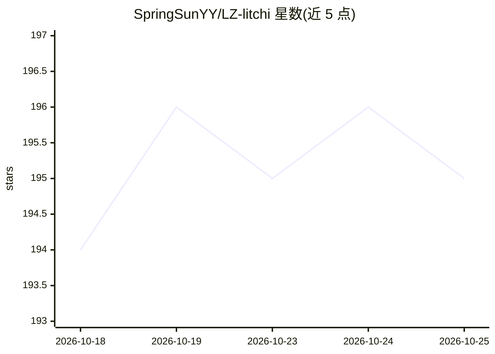

# SpringSunYY/LZ-litchi

⭐ 202 · Java · MIT · 推送 2026-10-25 · [GitHub](https://github.com/SpringSunYY/LZ-litchi) · [官网](https://www.litchi.work) · 个人维护 · 中文 README

**基于芋道二次开发的企业级低代码平台，含 AI 模块与以图搜图**

基于 JDK 21、Spring Boot 3.4.5、Vue 3 与 VbenAdmin 的前后端分离企业级开发平台，基于芋道框架二次开发。内置 RBAC 权限、SaaS 多租户、Flowable 工作流（SIMPLE 仿钉钉/BPMN 设计器）、代码生成、在线国际化、系统监控等，业务模块含 ERP、CRM 与 AI 大模型模块；以图搜图集成 dino/siglip/clip 模型与 Milvus 向量库（可删除）。国际化数据由 AI 生成 Key/翻译脚本维护。采用 MIT 协议，需 JDK21、MySQL、Redis 环境从源码启动，另提供前端独立仓库与演示地址。

## 筛选速览

| 维度 | 判定 | 备注 |
|---|---|---|
| AI 角色 | `ai-enhanced` | 去掉 AI 部分产品仍成立 |
| 许可风险 | `permissive` | MIT |
| 部署形态 | `None` |  |
| 模型依赖 | — | README 未给出锁定关系 |
| 硬件要求 | — | 无带数字的原话,不猜 |
| 安装摩擦 | `medium` | 含编译或系统依赖之一 |
| 成熟度 | — | 结构信号不足 |

## 能力要点

- SaaS 多租户 + 租户套餐权限体系
- Flowable 工作流，SIMPLE 拖拽设计器与 BPMN 设计器
- 代码生成器一键生成 Java/Vue/SQL/接口文档
- AI 大模型模块 + dino/siglip/clip 与 Milvus 实现以图搜图

## 适用场景

- 快速搭建带权限与多租户的管理后台
- 搭建含审批流的 OA/ERP/CRM 企业系统
- 为业务系统集成 AI 大模型与以图搜图能力

## 场景标签

`代码生成` `语义搜索` · 领域:编码与开发

## 证据(README 行号)

> L63: * 以图搜图，集成dino、siglip、clip三大模型与milvus向量数据库实现以图搜图，不需要可以删除，参考教程视频第11集
> L110: * 业务系统（按需）：ERP 系统、CRM 系统、AI 大模型
> L206: |`litchi-module-ai`|AI 大模型的 Module 模块|

## 星数曲线

2026-10-18 194 → 2026-10-25 195（+1）

---
*卡片 v1 · prompt 1.4 · 生成 2026-10-22 · 置信度 high · 依据 README sha `3cc3f7b79b1d` · [字段定义](../../DATASET.md)*
