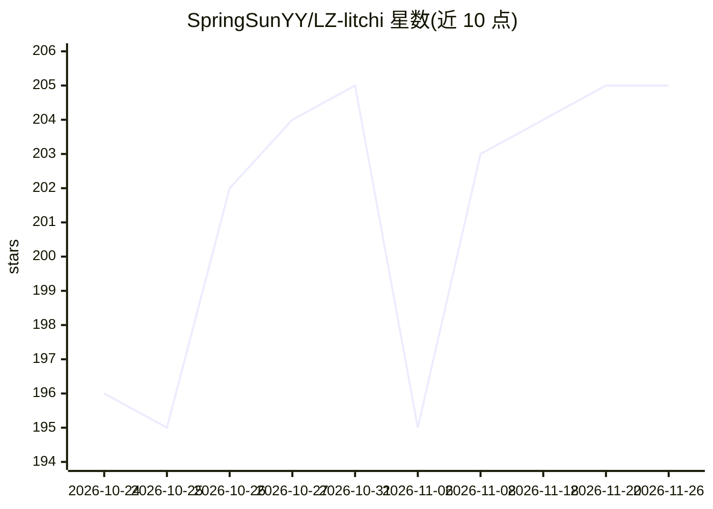

# SpringSunYY/LZ-litchi

⭐ 205 · Java · MIT · 推送 2026-10-25 · [GitHub](https://github.com/SpringSunYY/LZ-litchi) · [官网](https://www.litchi.work) · 个人维护 · 中文 README

**基于 JDK21+SpringBoot3+Vue3 的企业级快速开发平台**

以芋道为基座二次开发的前后端分离开发平台，后端 Spring Boot 多模块、前端 Vben Admin，内置用户/角色/租户管理、Flowable 工作流、代码生成、在线国际化、系统监控等模块，业务模块含 ERP、CRM 与 AI 大模型模块；AI 部分包括集成 dino/siglip/clip 模型与 Milvus 向量数据库的以图搜图功能（可删除），以及生成国际化 Key 时使用 AI。默认初始化 SQL 不含国际化数据，需运行 Python 脚本生成或联系作者获取；MySQL 初始化脚本已提供，其他数据库需自行适配。

## 筛选速览

| 维度 | 判定 | 备注 |
|---|---|---|
| AI 角色 | `ai-enhanced` | 去掉 AI 部分产品仍成立 |
| 许可风险 | `permissive` | MIT |
| 部署形态 | `None` |  |
| 模型依赖 | — | README 未给出锁定关系 |
| 硬件要求 | — | 无带数字的原话,不猜 |
| 安装摩擦 | `medium` | 含编译或系统依赖之一 |
| 成熟度 | — | 结构信号不足 |

## 能力要点

- RBAC 权限、SaaS 多租户、Flowable 工作流与代码生成一体化内置
- 集成 dino/siglip/clip 三模型与 Milvus 向量数据库实现以图搜图（可移除）
- 支持 MySQL/Oracle/PostgreSQL/达梦/TiDB 等多种数据库（初始化 SQL 仅提供 MySQL）
- 内置 ERP、CRM、AI 大模型等按需业务模块

## 适用场景

- 快速搭建管理后台、ERP、CRM、OA 等企业级系统
- 需要多租户 SaaS 权限隔离的业务系统
- 需要以图搜图能力的图片管理系统
- 需要多语言国际化在线配置的全球化业务

## 场景标签

`工作流自动化` `代码生成` · 领域:效率与自动化

## 证据(README 行号)

> L63: * 以图搜图，集成dino、siglip、clip三大模型与milvus向量数据库实现以图搜图，不需要可以删除，参考教程视频第11集
> L110: * 业务系统（按需）：ERP 系统、CRM 系统、AI 大模型
> L298: > 环境：JDK21、MySQL8.0、Redis，必须要有的哦，没有可以找找资料下载就行了

## 星数曲线

2026-10-24 196 → 2026-11-26 205（+9）

---
*卡片 v1 · prompt 1.4 · 生成 2026-11-25 · 置信度 high · 依据 README sha `58904b0a03f0` · [字段定义](../../DATASET.md)*
