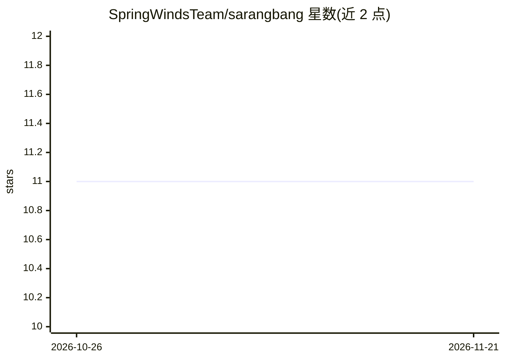

# SpringWindsTeam/sarangbang

⭐ 11 · Python · Apache-2.0 · 推送 2026-10-26 · [GitHub](https://github.com/SpringWindsTeam/sarangbang) · [官网](https://pypi.org/project/sarangbang/) · 组织维护

**面向研究者的韩语群聊 LLM 舆论模拟引擎**

Python 库与 CLI 工具，模拟虚拟市民在韩语小群聊中就政策、产品等话题的多轮对话，输出对话记录供分析兴趣与意见分歧。为 EXAONE、A.X 等韩国模型调整了提示词与后处理，通过 OpenAI 兼容 /chat/completions 接入多家 API、中转平台及 vLLM/Ollama 本地部署，提供预设一键切换、发言优先级调度、锚点/基础双模型分层、JSON 场景文件与 Nemotron-Personas-Korea 市民数据集适配器。运行时依赖仅 httpx。

## 筛选速览

| 维度 | 判定 | 备注 |
|---|---|---|
| AI 角色 | `ai-native` | 本体是模型或模型工具 |
| 许可风险 | `permissive` | Apache-2.0 |
| 部署形态 | `library` | 以包/库形式分发 |
| 模型依赖 | local-ok | 支持本地模型 |
| 硬件要求 | — | 无带数字的原话,不猜 |
| 安装摩擦 | `low` | 无编译、无系统依赖或容器化 |
| 成熟度 | — | 结构信号不足 |

## 能力要点

- 预设切换韩国本地 API、中转平台与本地部署的 8 种 provider
- 发言优先级调度与锚点/基础模型分层调用
- NemotronKoreaAdapter 加载百万虚拟韩国市民数据集
- JSON 场景文件与 quickstart/run/doctor 等 CLI

## 适用场景

- 模拟市民对某项政策在群聊中的讨论过程
- 分析虚拟市民的兴趣点与意见差异
- 用韩语开源模型测试群聊式社会模拟

## 场景标签

`科研工具` · 领域:学习与行业

## 证据(README 行号)

> L7: **한국어 단톡방 여론 시뮬레이션 엔진**
> L69: sarangbang은 OpenAI 호환 `/chat/completions`만 쓰므로 **한국어 모델을 어디서 받아 쓰든 같은 코드로 돌아갑니다.** 세 갈래를 프리셋으로 넣어 두었습니다.
> L127: |**시나리오 파일과 CLI**|주제·시민·카드를 JSON 하나에 담아 `sarangbang run`으로 돌리고 결과를 JSON으로 저장합니다.|

## 星数曲线

2026-10-26 11 → 2026-11-21 11（+0）

---
*卡片 v1 · prompt 1.4 · 生成 2026-11-18 · 置信度 high · 依据 README sha `dda5107cdec4` · [字段定义](../../DATASET.md)*
