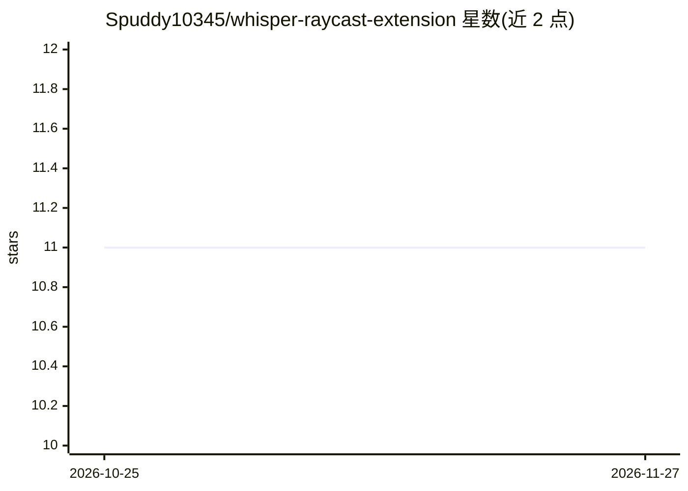

# Spuddy10345/whisper-raycast-extension

⭐ 11 · TypeScript · 推送 2026-10-30 · [GitHub](https://github.com/Spuddy10345/whisper-raycast-extension) · 个人维护

**Raycast 本地语音转文字扩展：录音→whisper.cpp 转录→AI 润色**

运行于 Raycast 的语音听写扩展：通过 sox 录音，调用本机 whisper.cpp 转录为文本，转录历史本地保存（上限 100 条）。可选开启 AI 润色，支持 Raycast AI（需 Pro）、本地 Ollama 或任意 OpenAI v1 兼容 API，配合自定义提示词重新排版、纠错，并可生成独立脚本命令与快捷键。依赖 Raycast、whisper.cpp、sox 及模型文件，仅在 macOS 可用；提供 Raycast Store 安装与源码构建两种途径。

## 筛选速览

| 维度 | 判定 | 备注 |
|---|---|---|
| AI 角色 | `ai-native` | 本体是模型或模型工具 |
| 许可风险 | `permissive` | — |
| 部署形态 | `library` | 以包/库形式分发 |
| 模型依赖 | local-ok | 支持本地模型 |
| 硬件要求 | — | 无带数字的原话,不猜 |
| 安装摩擦 | `low` | 无编译、无系统依赖或容器化 |
| 成熟度 | — | 结构信号不足 |

## 能力要点

- whisper.cpp 本地转录，不上传音频
- AI 润色可选用 Raycast AI / Ollama / OpenAI 兼容 API
- 扩展内下载与管理多种 Whisper 模型
- 自定义提示词可生成独立脚本命令并绑定快捷键

## 适用场景

- 在 macOS 上随时按键听写并粘贴到当前窗口
- 把口述内容按自定义提示词整理成邮件/会议纪要格式
- 完全本地运行，无需云端即可完成语音转文字

## 场景标签

`语音识别` · 领域:感知与多模态

## 证据(README 行号)

> L5: Effortlessly convert your speech to text directly within Raycast using the power of `whisper.cpp`. This extension pr
> L60: - **Dictate:** Convert speech to text using Whisper directly (no AI refinement).

## 星数曲线

2026-10-25 11 → 2026-11-27 11（+0）

---
*卡片 v1 · prompt 1.4 · 生成 2026-11-18 · 置信度 mid · 依据 README sha `f543d25a485f` · [字段定义](../../DATASET.md)*
