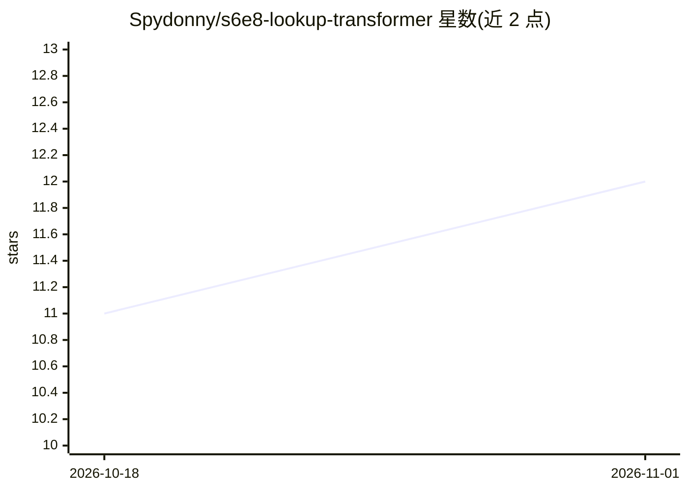

# Spydonny/s6e8-lookup-transformer

⭐ 12 · Jupyter Notebook · MIT · 推送 2026-10-08 · [GitHub](https://github.com/Spydonny/s6e8-lookup-transformer) · [官网](https://www.kaggle.com/code/tamerlanomralinov/s6e8-lookup-transformer-insights-lb-0-97041) · 个人维护

**Kaggle S6E8 表格赛题的 Lookup-Transformer 获奖方案与训练管线**

面向 Kaggle Playground S6E8（预测智能手机成瘾）的竞赛解决方案仓库：作者设计了 Lookup-Transformer 架构，为每列学习精确值嵌入表并结合周期线性数值嵌入，用四层 Transformer 注意力建模原始特征与衍生屏幕时间预算 token 的交互，可与 CatBoost/LightGBM 做秩融合，公开榜 ROC AUC 0.97041。该架构被第 14 名方案采用，README 列出 11 个可验证的 Kaggle 引用。提供 Kaggle notebook 与本地运行两种途径，本地需 Python 3.10/3.11，推荐 CUDA GPU，也支持 CPU 执行，数据下载依赖 Kaggle CLI 与接受比赛规则。

## 筛选速览

| 维度 | 判定 | 备注 |
|---|---|---|
| AI 角色 | `ai-native` | 本体是模型或模型工具 |
| 许可风险 | `permissive` | MIT |
| 部署形态 | `None` |  |
| 模型依赖 | — | README 未给出锁定关系 |
| 硬件要求 | — | 无带数字的原话,不猜 |
| 安装摩擦 | `medium` | 含编译或系统依赖之一 |
| 成熟度 | — | 结构信号不足 |

## 能力要点

- 每列精确值学习嵌入表 + 周期线性数值嵌入 + 四层 Transformer 注意力
- 屏幕时间预算约束特征（不等式残差、总量与占比 token）
- 公开榜 ROC AUC 0.97041，三模型融合 OOF 0.96940
- 提供 notebook、可复用架构源码 src/lookup_transformer.py 与命令行训练脚本

## 适用场景

- 复现或学习该 Kaggle 赛题的高分方案
- 借鉴精确值嵌入架构用于合成数据的表格建模
- 将预算约束特征工程迁移到其他竞赛或数据集

## 场景标签

 · 领域:机器学习/表格分类

## 证据(README 行号)

> L12: I developed Lookup-Transformer for Predicting Smartphone Addiction — Kaggle Playground S6E8. I started by investiga

## 星数曲线

2026-10-18 11 → 2026-11-01 12（+1）

---
*卡片 v1 · prompt 1.4 · 生成 2026-11-01 · 置信度 high · 依据 README sha `f53c76fe1333` · [字段定义](../../DATASET.md)*
