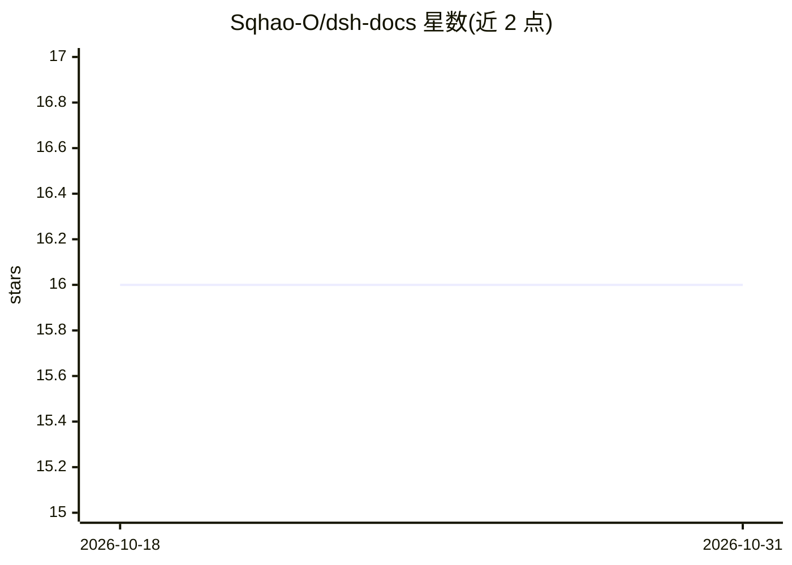

# Sqhao-O/dsh-docs

⭐ 16 · TypeScript · MIT · 推送 2026-10-16 · [GitHub](https://github.com/Sqhao-O/dsh-docs) · 个人维护 · 中文 README

**DeepSeek Harness 的全本地文档解析/OCR 插件**

面向 DeepSeek Harness agent 的文档智能插件：把 PDF、DOCX、XLSX、PPTX、Markdown、HTML、CSV 及图片/扫描件解析为 Markdown、纯文本或结构化 JSON，OCR 走完全离线的 Tesseract 管线（英文与简体中文）。自带 SHA-256 校验的固定版 Python 运行时，Windows x64 开箱即用，其他平台可用 Node 引擎（无 OCR）；通过 dshdoc_* 工具集暴露给 agent，文件读取限定在显式授权目录内，不做任何网络请求。以 npm 包经 dsh plugin 命令安装。

## 筛选速览

| 维度 | 判定 | 备注 |
|---|---|---|
| AI 角色 | `ai-native` | 本体是模型或模型工具 |
| 许可风险 | `permissive` | MIT |
| 部署形态 | `library` | 以包/库形式分发 |
| 模型依赖 | locked-api |  |
| 硬件要求 | — | 无带数字的原话,不猜 |
| 安装摩擦 | `low` | 无编译、无系统依赖或容器化 |
| 成熟度 | — | 结构信号不足 |

## 能力要点

- PDF/Office/图片/扫描件解析为 Markdown、文本或 JSON
- 完全离线的 Tesseract OCR（eng/chi_sim），无需 API key 与 Docker
- 固定版嵌入式 Python 运行时（CPython 3.11.9 + xberg），SHA-256 校验
- 路径白名单、字节快照、拒绝 URL 输入等安全模型

## 适用场景

- 让本地 agent 直接读取项目里的 PDF/Office/扫描文档
- 在离线环境对图片和扫描件做 OCR 文字提取
- 从 Excel/财报文件中提取表格供 agent 分析

## 场景标签

`文档解析` `OCR` · 领域:知识与检索

## 证据(README 行号)

> L7: **dsh-docs** gives your DeepSeek Harness agent real document intelligence —
> L10: page or image and a fully offline OCR pipeline reads it for you. No Docker, no
> L48: - PNG, JPEG, TIFF, WebP, and scanned PDFs through local OCR

## 星数曲线

2026-10-18 16 → 2026-10-31 16（+0）

---
*卡片 v1 · prompt 1.4 · 生成 2026-10-30 · 置信度 mid · 依据 README sha `35ddca76954e` · [字段定义](../../DATASET.md)*
