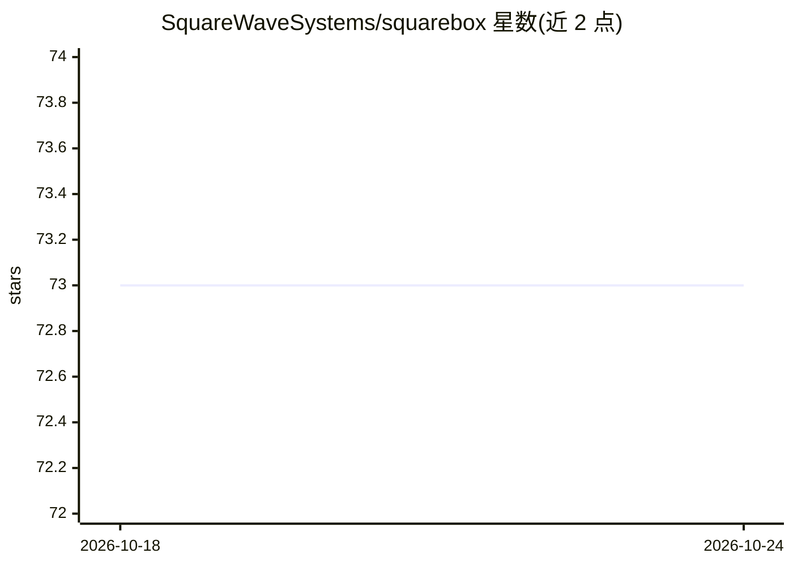

# SquareWaveSystems/squarebox

⭐ 73 · Shell · MIT · 推送 2026-10-17 · [GitHub](https://github.com/SquareWaveSystems/squarebox) · 组织维护

**容器化便携开发环境：预装现代 CLI/TUI 工具与 AI 编码助手**

基于 Docker/Podman 的可移植终端开发环境，一键安装后在桌面、服务器或 Codespace 中运行同一套工具集。内置 bat、fzf、ripgrep、lazygit、yazi 等 CLI/TUI 工具，可选安装 Claude Code、Gemini CLI、Codex CLI、opencode 等 AI 编码助手及 Neovim、helix 等编辑器。工作区与持久卷在重建后保留，首次运行提供向导式配置，可通过修改 Dockerfile 与工具注册表自定义内容。AI 助手为可选组件，非环境运行前提。

## 筛选速览

| 维度 | 判定 | 备注 |
|---|---|---|
| AI 角色 | `ai-enhanced` | 去掉 AI 部分产品仍成立 |
| 许可风险 | `permissive` | MIT |
| 部署形态 | `self-host` | docker 或自建部署 |
| 模型依赖 | — | README 未给出锁定关系 |
| 硬件要求 | — | 无带数字的原话,不猜 |
| 安装摩擦 | `low` | 无编译、无系统依赖或容器化 |
| 成熟度 | — | 结构信号不足 |

## 能力要点

- 一行脚本安装（Bash/PowerShell），支持 Docker 或 Podman 运行时自动检测
- 内置约 20 个 CLI/TUI 工具，可选 AI 编码助手、编辑器、多路复用器按需组合
- workspace 与 squarebox-home 持久卷在 Box 重建后保留
- 首运行向导配置 Git 身份、GitHub 登录与可选工具，sqrbx-setup 可随时重配

## 适用场景

- 在不同机器上获得一致的终端开发环境
- 在服务器或 Codespaces 中快速搭建带 AI 编码助手的开发箱
- 按需挑选 AI 助手、编辑器与 CLI 工具组合，重建时自动复用选择

## 场景标签

 · 领域:开发者工具/容器化环境

## 证据(README 行号)

> L3: **Modern CLI/TUI tools and AI coding assistants in a portable development Box.**
> L84: ### AI Coding Assistants
> L88: |Claude Code|AI coding assistant|

## 星数曲线

2026-10-18 73 → 2026-10-24 73（+0）

---
*卡片 v1 · prompt 1.4 · 生成 2026-10-24 · 置信度 mid · 依据 README sha `a7bad53d52a1` · [字段定义](../../DATASET.md)*
