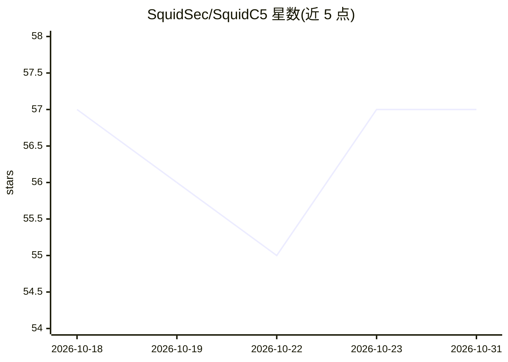

# SquidSec/SquidC5

⭐ 57 · Python · MIT · 推送 2026-10-23 · [GitHub](https://github.com/SquidSec/SquidC5) · [官网](https://squidoffense.com/) · 组织维护

**给红队/渗透测试者的带 AI 操作员的 C5 团队服务器**

面向授权红队与渗透测试的 C2/C5 团队服务器，覆盖命令与控制、策略与 HITL、团队协作、交战 ROE 与审计链等。AI 部分：INKO 神经操作员聊天、沙箱化 Admin AI、默认关闭的受限 MCP，以及可选的本地 Ollama 通道。提供 Docker 与本地 venv 安装、Linux amd64/arm64 二进制、Go 原生植入体（AEAD）与操作员 CLI。声明仅供授权测试使用。

## 筛选速览

| 维度 | 判定 | 备注 |
|---|---|---|
| AI 角色 | `ai-enhanced` | 去掉 AI 部分产品仍成立 |
| 许可风险 | `permissive` | MIT |
| 部署形态 | `self-host` | docker 或自建部署 |
| 模型依赖 | local-ok | 支持本地模型 |
| 硬件要求 | — | 无带数字的原话,不猜 |
| 安装摩擦 | `low` | 无编译、无系统依赖或容器化 |
| 成熟度 | — | 结构信号不足 |

## 能力要点

- INKO 神经操作员聊天 + 沙箱化 Admin AI，MCP 默认关闭
- Go 原生植入体 sc5beacon（AEAD、SOCKS 反向拨号）与植入体工厂
- 不可变审计哈希链与 sc5 audit-verify 验证
- 多操作员协作（会话锁、交接包、团队聊天、逐操作员审计）

## 适用场景

- 授权红队行动中管理植入体、会话与监听器
- 通过 INKO AI 操作员以受控工具执行操作
- 交战期间执行 ROE 约束与审计合规核验

## 场景标签

`网络安全` · 领域:学习与行业

## 证据(README 行号)

> L20: Security-first, AI-native C5 teamserver for **authorized** red team and penetration testing. Built by **SquidSec**.
> L38: |**Cognitive**|INKO (Intelligent Neural Kinetic Operator) + sandboxed Admin AI + restricted MCP|
> L45: - **Dual AI** - MCP off by default; **INKO** neural operator chat (connection + model switcher, railed tools) + Adm

## 星数曲线

2026-10-18 57 → 2026-10-31 57（+0）

---
*卡片 v1 · prompt 1.4 · 生成 2026-10-24 · 置信度 high · 依据 README sha `d86c5be3acc9` · [字段定义](../../DATASET.md)*
