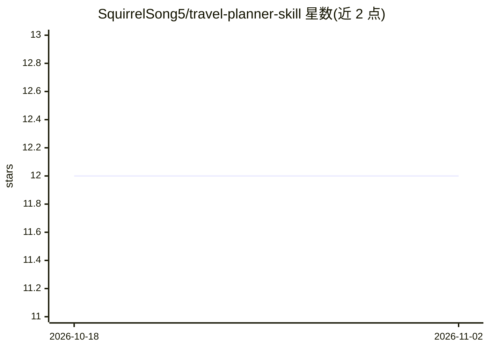

# SquirrelSong5/travel-planner-skill

⭐ 12 · Python · MIT · 推送 2026-08-24 · [GitHub](https://github.com/SquirrelSong5/travel-planner-skill) · [官网](https://squirrelsong5.github.io/travel-plans/chengdu-2026-09-18.html) · 个人维护 · 中文 README

**面向中国大陆行程的 AI Agent 旅行规划 Skill**

可安装到 Codex、Claude Code、Cursor 等 AI Agent 的旅行规划技能：用户告知目的地、日期、人数、预算和偏好后，Agent 调研小红书、官方运营方、高德地图、美团、携程等 5 类来源，编排每日路线并计算通勤时间，交付对话版攻略、单文件 HTML 行程页与结构化 trip.json，附来源与核对时间；冲突时以最新官方信息为准。通过 npx skills add 或 git clone 安装，另带 Python 本地校验与渲染脚本及 V0–V13 校验规则文档。

## 筛选速览

| 维度 | 判定 | 备注 |
|---|---|---|
| AI 角色 | `ai-native` | 本体是模型或模型工具 |
| 许可风险 | `permissive` | MIT |
| 部署形态 | `library` | 以包/库形式分发 |
| 模型依赖 | — | README 未给出锁定关系 |
| 硬件要求 | — | 无带数字的原话,不猜 |
| 安装摩擦 | `low` | 无编译、无系统依赖或容器化 |
| 成熟度 | — | 结构信号不足 |

## 能力要点

- 5 类信息源分工（小红书/官方/高德/美团/国内OTA）并保留来源与核对时间
- 同时生成对话版攻略、响应式单文件 HTML 与结构化 trip.json
- 行程变更后可只重新核对受影响的路线和费用
- 自带部署引导，推荐 GitHub Pages / Cloudflare Pages / Netlify / Vercel 托管

## 适用场景

- 让 AI Agent 规划中国大陆多日旅行行程
- 出发前复核开放时间、票价与可订状态
- 行程临时变化后调整路线和预算

## 场景标签

 · 领域:旅行规划/Agent 技能

## 证据(README 行号)

> L16: `travel-planner` 是一个可安装到 Codex、Claude Code、Cursor 等 AI Agent 的中国大陆旅行规划 Skill。安装后，只需告诉 AI 目的地、日期、人数、预算和偏好，它就会调研最新信息、
> L20: - **对话版攻略**：完整内容直接显示在聊天中；

## 星数曲线

2026-10-18 12 → 2026-11-02 12（+0）

---
*卡片 v1 · prompt 1.4 · 生成 2026-11-01 · 置信度 high · 依据 README sha `39327e85eb39` · [字段定义](../../DATASET.md)*
