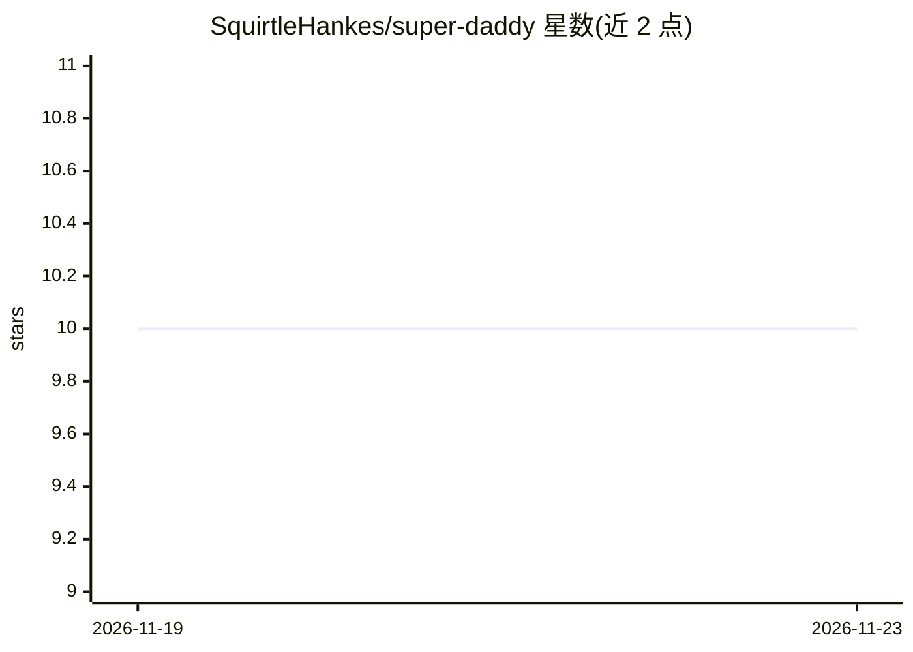

# SquirtleHankes/super-daddy

⭐ 10 · Python · 推送 2026-03-16 · [GitHub](https://github.com/SquirtleHankes/super-daddy) · 个人维护 · 中文 README

**给 AI Agent 用的 0-6 岁科学育儿 Skill：喂养/生长/疫苗等 12 模块**

以 SKILL.md 为核心配置的育儿领域 Skill，供 AI Agent 加载后充当育儿顾问。包含 5 个内置知识模块与多个 Python 脚本工具：按月龄生成喂养计划 Excel、基于 WHO 百分位分析生长曲线并输出 HTML 报告、生成宝宝成长主页、抓取并分类育儿资讯。知识内容引用 WHO、AAP、中国营养学会等机构指南，全部输出为纯静态文件，无需服务器。README 附免责声明，信息仅供参考非医疗建议。

## 筛选速览

| 维度 | 判定 | 备注 |
|---|---|---|
| AI 角色 | `ai-native` | 本体是模型或模型工具 |
| 许可风险 | `none` | — |
| 部署形态 | `library` | 以包/库形式分发 |
| 模型依赖 | — | README 未给出锁定关系 |
| 硬件要求 | — | 无带数字的原话,不猜 |
| 安装摩擦 | `low` | 无编译、无系统依赖或容器化 |
| 成熟度 | — | 结构信号不足 |

## 能力要点

- 12 大功能模块覆盖喂养、睡眠、疫苗、健康自查、早教、开支管理等
- 脚本生成 WHO P3-P97 生长曲线 HTML 报告与喂养计划 Excel
- 知识来源标注 WHO、AAP、中国营养学会、中国疾控中心等
- 输出均为纯静态文件（Excel/HTML），无需服务器

## 适用场景

- 让 AI Agent 按宝宝月龄生成个性化喂养计划
- 输入身高体重数据做 WHO 标准生长曲线分析
- 一键生成宝宝成长主页与育儿资讯报告

## 场景标签

`AI 助手` `网页抓取` `数据分析` · 领域:效率与自动化

## 证据(README 行号)

> L3: > 0-6 岁婴幼儿一站式科学养娃 AI Skill，基于 WHO、AAP、中国营养学会等权威机构指南。
> L7: **Super Dad** 是一个为 AI Agent 设计的育儿领域 Skill，让 AI 变身专业的育儿顾问。它涵盖了从喂养管理到早教互动的全方位育儿场景，提供 **12 大功能模块**，帮助新手爸妈科学、从容地养育宝宝。

## 星数曲线

2026-11-19 10 → 2026-11-23 10（+0）

---
*卡片 v1 · prompt 1.4 · 生成 2026-11-20 · 置信度 mid · 依据 README sha `3a0536dc23d3` · [字段定义](../../DATASET.md)*
