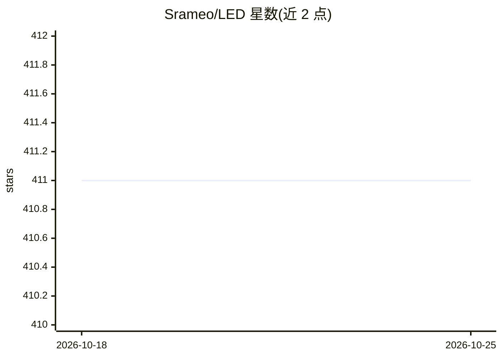

# Srameo/LED

⭐ 412 · Python · NOASSERTION · 推送 2025-12-17 · [GitHub](https://github.com/Srameo/LED) · [官网](https://srameo.github.io/projects/led-iccv23/) · 组织维护 · 中文 README

**免标定的 RAW 图像去噪管线，面向极低光照成像研究**

ICCV 2023 / NeurIPS 2025 论文的官方实现：LED 是 Calibration-Free（隐式标定）的 RAW 去噪管线，宣称仅需两对噪声-干净图像即可训练（训练时间少于 4 分钟），并支持在用户自有相机上微调预训练模型（cutomized_denoiser.py）。模型库提供基于 UNet/Restormer/NAFNet 的预训练权重（Google Drive 下载），测试脚本 image_process.py 处理自有 RAW 图像。UltraLED（超高动态范围场景）的训练与评测代码另见 UltraLED.md。许可为 CC BY-NC 4.0，仅限非商业用途，商业使用需联系作者授权。

## 筛选速览

| 维度 | 判定 | 备注 |
|---|---|---|
| AI 角色 | `ai-native` | 本体是模型或模型工具 |
| 许可风险 | `none` | NOASSERTION |
| 部署形态 | `None` |  |
| 模型依赖 | — | README 未给出锁定关系 |
| 硬件要求 | — | 无带数字的原话,不猜 |
| 安装摩擦 | `low` | 无编译、无系统依赖或容器化 |
| 成熟度 | — | 结构信号不足 |

## 能力要点

- 免标定（隐式标定）RAW 去噪管线，面向极低光照条件
- 两对图像即可微调适配自有相机（cutomized_denoiser.py）
- 模型库含 UNet/Restormer/NAFNet 多架构预训练权重
- 提供测试自有 RAW 图像的 image_process.py 脚本

## 适用场景

- 我在极低光照下采集的 RAW 图像需要去噪且没有噪声标定数据
- 我想用自己的相机采集少量图像对，微调适配去噪模型
- 我在做 RAW 去噪方法的学术基准测试

## 场景标签

`图像视频处理` · 领域:感知与多模态

## 证据(README 行号)

> L29: LED is a **Calibration-Free** (or called implicit calibration) Pipeline for RAW Denoising (currently for extremely 
> L32: Achieveing SOTA performance in 2 paired data and training time less than 4mins !

## 星数曲线

2026-10-18 411 → 2026-10-25 411（+0）

---
*卡片 v1 · prompt 1.4 · 生成 2026-10-21 · 置信度 high · 依据 README sha `a614d5577827` · [字段定义](../../DATASET.md)*
