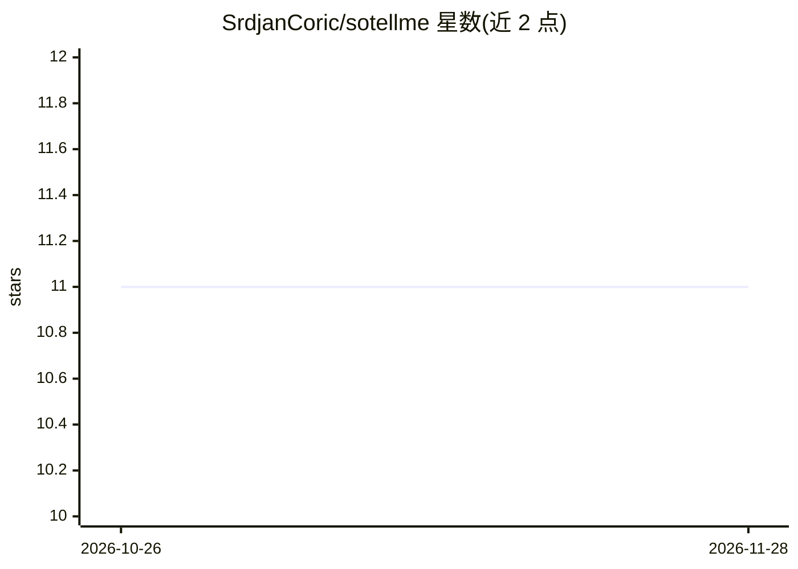

# SrdjanCoric/sotellme

⭐ 11 · Python · MIT · 推送 2026-07-06 · [GitHub](https://github.com/SrdjanCoric/sotellme) · 个人维护

**面向求职者的行为面试模拟教练：基于简历与职位动态追问并评分**

读取用户简历与职位发布（链接、PDF、粘贴文本），可从公开页面构建公司简报，随后以对话形式进行 8-14 题的行为面试，根据上一回答动态追问而非固定脚本；结束后对每个回答按 STAR 结构、具体性、责任归属打分，生成含改进建议与学习计划的 Markdown 报告。基于 LangGraph 构建，支持浏览器本地 Web 界面或终端运行，数据留在本机，仅通过用户自备的 API key 调用模型服务商。

## 筛选速览

| 维度 | 判定 | 备注 |
|---|---|---|
| AI 角色 | `ai-native` | 本体是模型或模型工具 |
| 许可风险 | `permissive` | MIT |
| 部署形态 | `None` |  |
| 模型依赖 | locked-api |  |
| 硬件要求 | — | 无带数字的原话,不猜 |
| 安装摩擦 | `low` | 无编译、无系统依赖或容器化 |
| 成熟度 | — | 结构信号不足 |

## 能力要点

- 由 CV 与职位发布生成面试会话，按回答动态追问
- 按 STAR、具体性、责任归属逐答评分并输出 Markdown 报告
- 支持 Anthropic/Google/OpenAI 多服务商与 fast/smart 双模型槽位配置
- 内置 Langfuse 评测流程与合成候选人模拟脚本

## 适用场景

- 面试前用目标职位和简历做针对性模拟练习
- 上传已有面试逐字稿获取逐答评分与改进建议
- 个人隐私敏感场景下全程本地运行、仅自备 key

## 场景标签

`AI 助手` · 领域:对话与助手

## 证据(README 行号)

> L14: You give it your CV and the job posting, and it interviews you against both, plus a
> L19: 14 questions. When you're done, it reads the whole transcript and scores every answer on
> L20: STAR structure, specificity, and ownership against your target level, then writes you a

## 星数曲线

2026-10-26 11 → 2026-11-28 11（+0）

---
*卡片 v1 · prompt 1.4 · 生成 2026-11-18 · 置信度 high · 依据 README sha `a4d3d7f9bb2b` · [字段定义](../../DATASET.md)*
