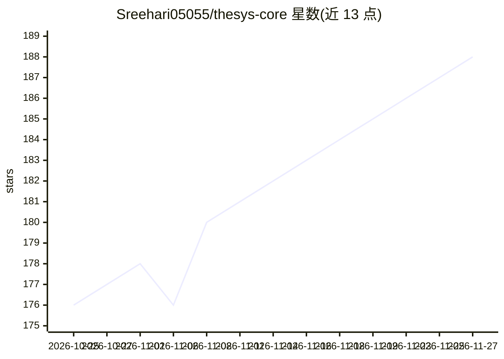

# Sreehari05055/thesys-core

⭐ 188 · TypeScript · AGPL-3.0 · 推送 2026-11-26 · [GitHub](https://github.com/Sreehari05055/thesys-core) · 个人维护

**研究者的本地文献工作台：论文检索、PDF 问答与引用导出**

开源研究工作台：从 OpenAlex 与 arXiv 检索开放获取论文、上传 PDF 到个人文献库，对论文提问时引用会跳转至 PDF 对应位置并高亮被检索片段（Focused/Full 两种模式），支持选中文本提问、按问题对比两篇论文（由 TypeSafe Jev 判定佐证/矛盾/中立）、生成结构化文档摘要与图表描述，并导出 BibTeX/RIS/EndNote/CSV 引用。RAG 流程为 Docling 解析、Chroma 存储、BGE 嵌入与重排；聊天需 OpenAI API key，默认 Docker 部署，GPU 加速可选。

## 筛选速览

| 维度 | 判定 | 备注 |
|---|---|---|
| AI 角色 | `ai-native` | 本体是模型或模型工具 |
| 许可风险 | `viral` | AGPL-3.0 |
| 部署形态 | `self-host` | docker 或自建部署 |
| 模型依赖 | — | README 未给出锁定关系 |
| 硬件要求 | — | 无带数字的原话,不猜 |
| 安装摩擦 | `low` | 无编译、无系统依赖或容器化 |
| 成熟度 | — | 结构信号不足 |

## 能力要点

- 引用点击跳转 PDF 并高亮检索片段（Focused/Full 两种粒度）
- 两篇论文按同一问题对比，逐对标注佐证/矛盾/中立及置信度
- OpenAlex + arXiv 合并检索开放获取文献
- 四种引用格式导出，OCR 处理扫描版 PDF 可选开启

## 适用场景

- 搭建本地文献库并对论文提问、溯源到原文位置
- 核实两篇论文对同一论断是否一致
- 检索开放获取论文并导出为投稿引用格式

## 场景标签

`RAG` `科研工具` `文档问答` · 领域:知识与检索

## 证据(README 行号)

> L7: Research workspace: search open-access papers (OpenAlex and arXiv), upload PDFs, ask questions with on-page highligh
> L57: - **RAG:** Docling ingest → Chroma + BGE embeddings → BGE reranker

## 星数曲线

2026-10-25 176 → 2026-11-27 188（+12）

---
*卡片 v1 · prompt 1.4 · 生成 2026-11-27 · 置信度 high · 依据 README sha `fa6b1ae25d55` · [字段定义](../../DATASET.md)*
