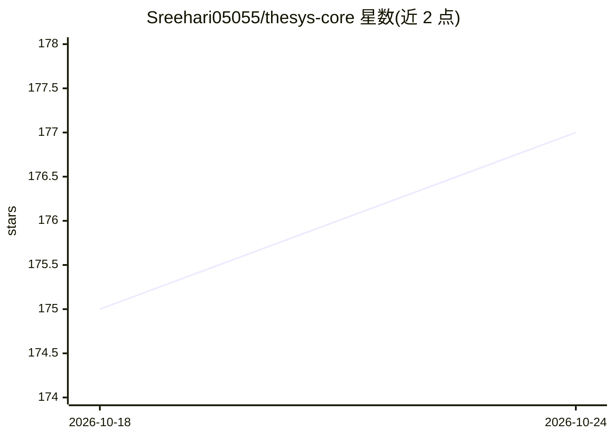

# Sreehari05055/thesys-core

⭐ 177 · TypeScript · AGPL-3.0 · 推送 2026-10-14 · [GitHub](https://github.com/Sreehari05055/thesys-core) · 个人维护

**本地优先的科研文献工作区：检索、RAG 问答与引文导出**

面向科研用户的本地研究工作区：通过 OpenAlex 与 arXiv 检索开放获取论文，上传 PDF 后由 Docling 解析、Chroma 存储 BGE 向量并经 BGE 重排实现本地 RAG；聊天答案带引用，可点击跳转 PDF 并做全文或聚焦高亮，支持阅读模式选段提问、文献摘要、图表引用及两篇论文按声明比对（TypeSafe Jev 分类一致/矛盾/中性）。引文可导出 BibTeX/RIS/EndNote/CSV。聊天需 OpenAI API key，论文、向量与聊天记录保存在本地磁盘。通过 Docker Compose 一键部署，或以 Python 3.11+ 与 Node.js 20+ 手动搭建前后端。

## 筛选速览

| 维度 | 判定 | 备注 |
|---|---|---|
| AI 角色 | `ai-native` | 本体是模型或模型工具 |
| 许可风险 | `viral` | AGPL-3.0 |
| 部署形态 | `self-host` | docker 或自建部署 |
| 模型依赖 | — | README 未给出锁定关系 |
| 硬件要求 | — | 无带数字的原话,不猜 |
| 安装摩擦 | `low` | 无编译、无系统依赖或容器化 |
| 成熟度 | — | 结构信号不足 |

## 能力要点

- 本地 RAG 管线：Docling 解析 → Chroma + BGE 向量 → BGE 重排，数据留在磁盘
- 答案引用可跳转 PDF 并做 Full/Focused 高亮，支持选段提问与图表引用
- 两篇论文按声明比对，TypeSafe Jev 分类为一致/矛盾/中性并给出置信度
- OpenAlex + arXiv 一站式检索，引文导出 BibTeX/RIS/EndNote/CSV 四种格式

## 适用场景

- 整理并管理自己的论文库，随时对 PDF 提问并获得带出处的回答
- 比对两篇论文在同一声明上是一致还是矛盾
- 检索开放获取文献并把引用导出到文献管理工具

## 场景标签

`RAG` `科研工具` `文档问答` · 领域:知识与检索

## 证据(README 行号)

> L7: Local research workspace: search open-access papers (OpenAlex and arXiv), upload PDFs, ask questions with on-page hi
> L57: - **Local RAG:** Docling ingest → Chroma + BGE embeddings → BGE reranker
> L59: - **Chat:** OpenAI via LangChain

## 星数曲线

2026-10-18 175 → 2026-10-24 177（+2）

---
*卡片 v1 · prompt 1.4 · 生成 2026-10-22 · 置信度 high · 依据 README sha `bfe3eeaf045b` · [字段定义](../../DATASET.md)*
