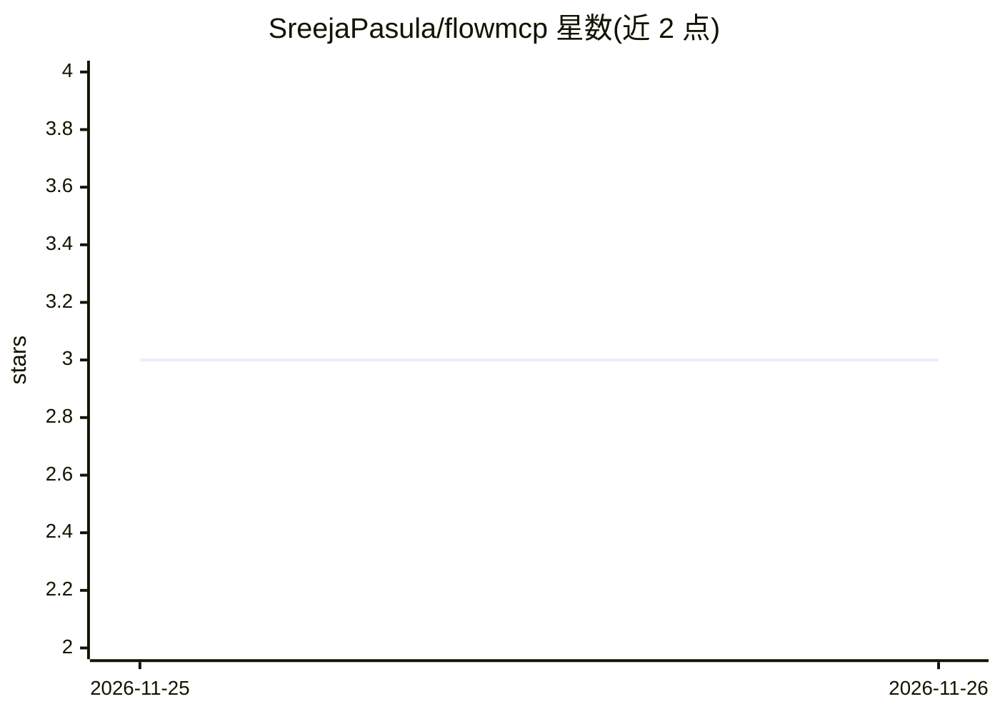

# SreejaPasula/flowmcp

⭐ 3 · Python · MIT · 推送 2026-11-23 · [GitHub](https://github.com/SreejaPasula/flowmcp) · 个人维护

**5 行代码搭建 RAG+MCP+LLM 管线的 Python/Java 库**

面向想在自有数据与工具上构建 AI 功能的开发者：把 LLM 调用、文档检索（RAG）与 MCP 工具调用整合为单个 Pipeline 对象，提供 ask/batch 问答、可复用 prompt 模板（支持 {query}/{context} 占位符与字面花括号转义）、PDF 文档加载扩展，并提供 Python（pip）与 Java（Maven）双语言 SDK。批处理为顺序执行、遇错即停，不使用 provider 侧批量 API。README 明确定位为 LangChain 的替代方案。

## 筛选速览

| 维度 | 判定 | 备注 |
|---|---|---|
| AI 角色 | `ai-ecosystem` | LLM/agent 周边工具 |
| 许可风险 | `permissive` | MIT |
| 部署形态 | `library` | 以包/库形式分发 |
| 模型依赖 | local-ok | 支持本地模型 |
| 硬件要求 | — | 无带数字的原话,不猜 |
| 安装摩擦 | `low` | 无编译、无系统依赖或容器化 |
| 成熟度 | — | 结构信号不足 |

## 能力要点

- Python 与 Java 双语言 SDK（pip 与 Maven 依赖）
- Pipeline 对象整合 RAG 检索、MCP 工具调用与 LLM 请求
- batch() 顺序批量问答与可复用 prompt 模板
- 支持 OpenAI/Anthropic/Ollama/Gemini 多提供商（Java 端部分为进行中）

## 适用场景

- 对自己的文档做检索增强问答
- 让 LLM 通过 MCP 调用外部工具执行操作
- 用本地 Ollama 模型搭建私有 RAG 管线

## 场景标签

`Agent 框架` `RAG` · 领域:Agent 开发

## 证据(README 行号)

> L3: **The simple way to build RAG + MCP + LLM pipelines. A clean alternative to LangChain.**
> L17: LangChain does this but needs hundreds of lines of setup. **flowmcp does it in 5 lines.**
> L103: ## How it works

## 星数曲线

2026-11-25 3 → 2026-11-26 3（+0）

---
*卡片 v1 · prompt 1.4 · 生成 2026-11-24 · 置信度 high · 依据 README sha `109f7d208e89` · [字段定义](../../DATASET.md)*
