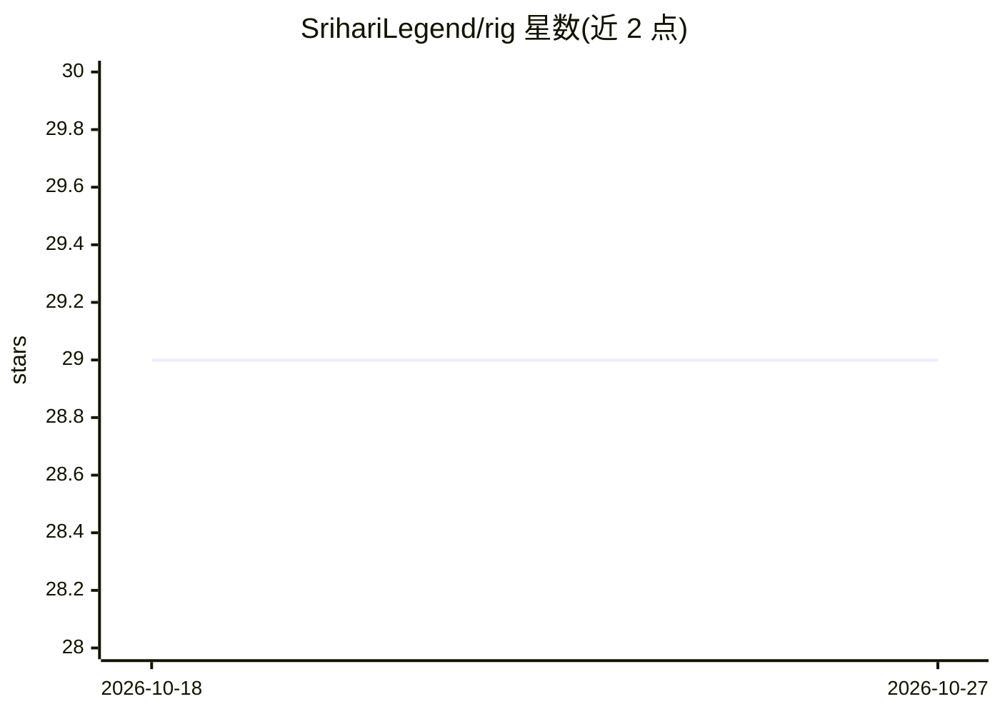

# SrihariLegend/rig

⭐ 29 · C · MIT · 推送 2026-08-15 · [GitHub](https://github.com/SrihariLegend/rig) · 个人维护

**C 语言单二进制 AI 编程 agent，接入主流 LLM 提供商**

约 23K 行 C 编写、约 600KB 单二进制的终端 AI 编程代理，运行时零依赖（libcurl/libssl/zlib 除外）。支持 Anthropic、OpenAI、Google、AWS Bedrock、Mistral 等提供商，单一 auth 流程配置、/model 命令中途切换。内置 bash/read/write/edit/grep/introspect 六个工具与按路径配置的权限系统，提供 TUI、会话持久化、JSON/RPC 输出模式，并通过 Lua 8 个原语做无构建步骤的扩展（自定义命令、工具、系统提示注入）。安装走 install.sh 下载预编译二进制（Linux/macOS amd64/arm64），或需 C11 编译器从源码 make 构建。

## 筛选速览

| 维度 | 判定 | 备注 |
|---|---|---|
| AI 角色 | `ai-native` | 本体是模型或模型工具 |
| 许可风险 | `permissive` | MIT |
| 部署形态 | `None` |  |
| 模型依赖 | locked-api |  |
| 硬件要求 | — | 无带数字的原话,不猜 |
| 安装摩擦 | `medium` | 含编译或系统依赖之一 |
| 成熟度 | — | 结构信号不足 |

## 能力要点

- 单一 C 二进制，零运行时依赖，内置 6 个编程工具与权限系统
- 多提供商支持：Anthropic/OpenAI/Google/Bedrock/Mistral 及 DeepSeek/xAI/Groq/OpenRouter
- Lua 扩展 8 原语，放置 .lua 文件即加载，无 SDK 与构建步骤
- 四种运行模式（TUI/Print/JSON/RPC）与会话持久化、YAML 工作流引擎

## 适用场景

- 在终端里让 AI 读写文件、执行命令完成编码任务
- 作为引擎在其上构建编辑器插件、CI agent 或内部工具
- 在多 LLM 提供商间用同一接口切换模型

## 场景标签

`编码 Agent` · 领域:编码与开发

## 证据(README 行号)

> L9: Rig is a coding agent written in C. One binary, no runtime deps, works with every major LLM provider.
> L27: - **Infrastructure, not product.** Rig is an engine. Build your own AI coding experience on top: editor plugins, CI

## 星数曲线

2026-10-18 29 → 2026-10-27 29（+0）

---
*卡片 v1 · prompt 1.4 · 生成 2026-10-26 · 置信度 high · 依据 README sha `2cd540cd7a2f` · [字段定义](../../DATASET.md)*
