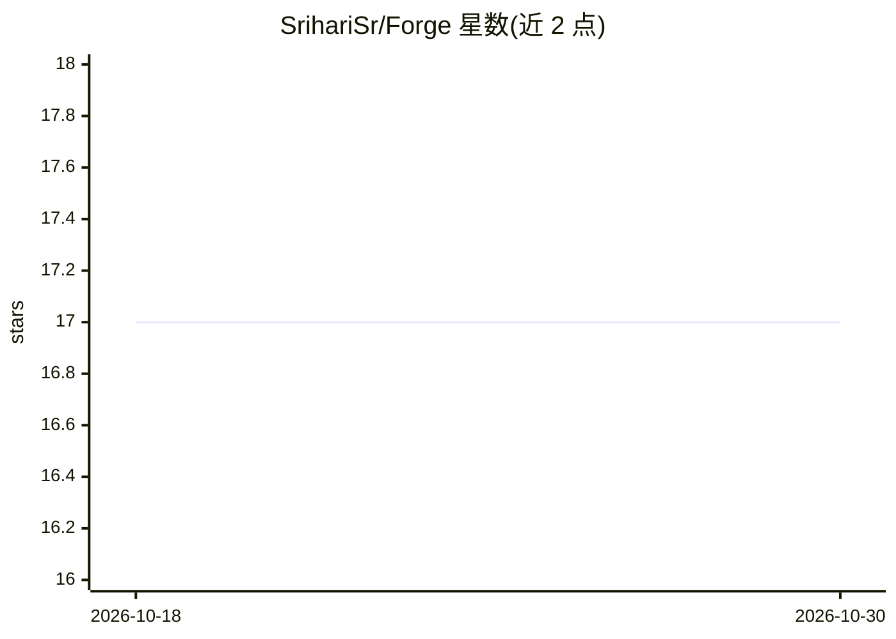

# SrihariSr/Forge

⭐ 17 · Python · MIT · 推送 2026-10-15 · [GitHub](https://github.com/SrihariSr/Forge) · 个人维护

**从零实现的 Python 可微机器学习框架，含生成 C 的深度学习编译器**

不依赖 PyTorch/TensorFlow/NumPy，从第一性原理实现反向模式自动微分张量库、Module 神经网络框架与 decoder-only transformer（多头因果注意力、pre-norm 残差块）。其上层的深度学习编译器构建计算图、规划算子融合、生成 C 源码并用 gcc 编译后经 ctypes 加载。矩阵乘法可分发到 Apple Metal、cuBLAS（NVIDIA）、rocBLAS（AMD）或 Accelerate BLAS，另含手写 CUDA/HIP 内核与蒙特卡洛期权定价示例。面向研究框架内部机制与编译器优化的开发者。

## 筛选速览

| 维度 | 判定 | 备注 |
|---|---|---|
| AI 角色 | `ai-ecosystem` | LLM/agent 周边工具 |
| 许可风险 | `permissive` | MIT |
| 部署形态 | `library` | 以包/库形式分发 |
| 模型依赖 | — | README 未给出锁定关系 |
| 硬件要求 | — | 无带数字的原话,不猜 |
| 安装摩擦 | `medium` | 含编译或系统依赖之一 |
| 成熟度 | — | 结构信号不足 |

## 能力要点

- 核心不依赖 PyTorch/TensorFlow/NumPy，autograd 到注意力全部自行实现
- 深度学习编译器：图分析、算子融合、生成并编译 C 代码（融合实测 2.36x 加速）
- 矩阵乘法多硬件后端：Metal/cuBLAS/rocBLAS/Accelerate/纯 Python
- 手写 CUDA 与 HIP 矩阵乘内核（naive/共享内存分块/寄存器分块三种）

## 适用场景

- 研究自动微分、注意力机制等深度学习底层实现原理
- 学习深度学习编译器的图构建与算子融合流程
- 在张量库上训练小规模 GPT 或做蒙特卡洛衍生品定价
- 对比手写内核与厂商 BLAS 库的性能

## 场景标签

`模型训练` `教程课程` · 领域:学习与行业

## 证据(README 行号)

> L8: A machine learning library written from scratch in Python, with a deep learning compiler that generates C.
> L10: No PyTorch, no TensorFlow, no NumPy in the core. Every operation, from the autograd engine to the attention mechani
> L24: **A deep learning compiler.** A separate front end that builds a graph, plans operator fusion, generates C source, 

## 星数曲线

2026-10-18 17 → 2026-10-30 17（+0）

---
*卡片 v1 · prompt 1.4 · 生成 2026-10-29 · 置信度 high · 依据 README sha `157f614b6614` · [字段定义](../../DATASET.md)*
