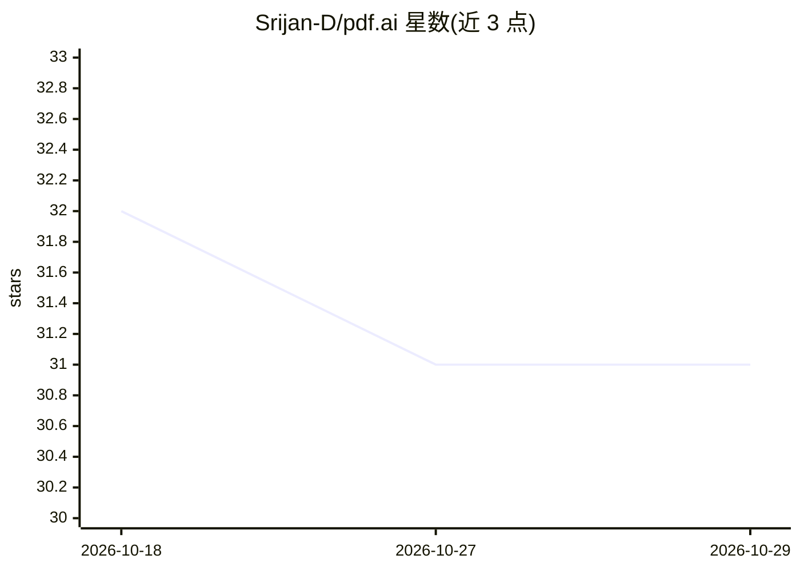

# Srijan-D/pdf.ai

⭐ 31 · TypeScript · 推送 2026-04-28 · [GitHub](https://github.com/Srijan-D/pdf.ai) · [官网](https://srijan-pdf-ai.vercel.app) · 个人维护

**与 PDF 对话问答的 AI 助手 Web 应用**

基于 Next.js 与 Vercel Edge Functions 构建的 PDF 问答应用：用户上传 PDF 后可通过 AI 进行提问、摘要与信息查找，采用嵌入与上下文检索机制生成回答。技术栈包括 OpenAI GPT、LangChain、Pinecone 向量数据库、Clerk 认证与 Drizzle ORM，面向 Edge 运行时环境部署。安装方式为克隆仓库源码本地运行，面向开发者自部署或贡献代码。

## 筛选速览

| 维度 | 判定 | 备注 |
|---|---|---|
| AI 角色 | `ai-native` | 本体是模型或模型工具 |
| 许可风险 | `none` | — |
| 部署形态 | `None` |  |
| 模型依赖 | — | README 未给出锁定关系 |
| 硬件要求 | — | 无带数字的原话,不猜 |
| 安装摩擦 | `low` | 无编译、无系统依赖或容器化 |
| 成熟度 | — | 结构信号不足 |

## 能力要点

- PDF 对话式问答与摘要
- 嵌入 + 上下文检索生成回答
- 基于 Vercel Edge Functions 的边缘部署

## 适用场景

- 上传论文或文档后提问获取摘要
- 在长 PDF 中查找特定信息
- 开发者克隆源码自部署 PDF 问答服务

## 场景标签

`文档问答` · 领域:知识与检索

## 证据(README 行号)

> L9: - ✨ Chat with your PDF using AI
> L11: - 🧠 Embedding + context retrieval for smarter answers

## 星数曲线

2026-10-18 32 → 2026-10-29 31（-1）

---
*卡片 v1 · prompt 1.4 · 生成 2026-10-26 · 置信度 high · 依据 README sha `f8fbd388569f` · [字段定义](../../DATASET.md)*
