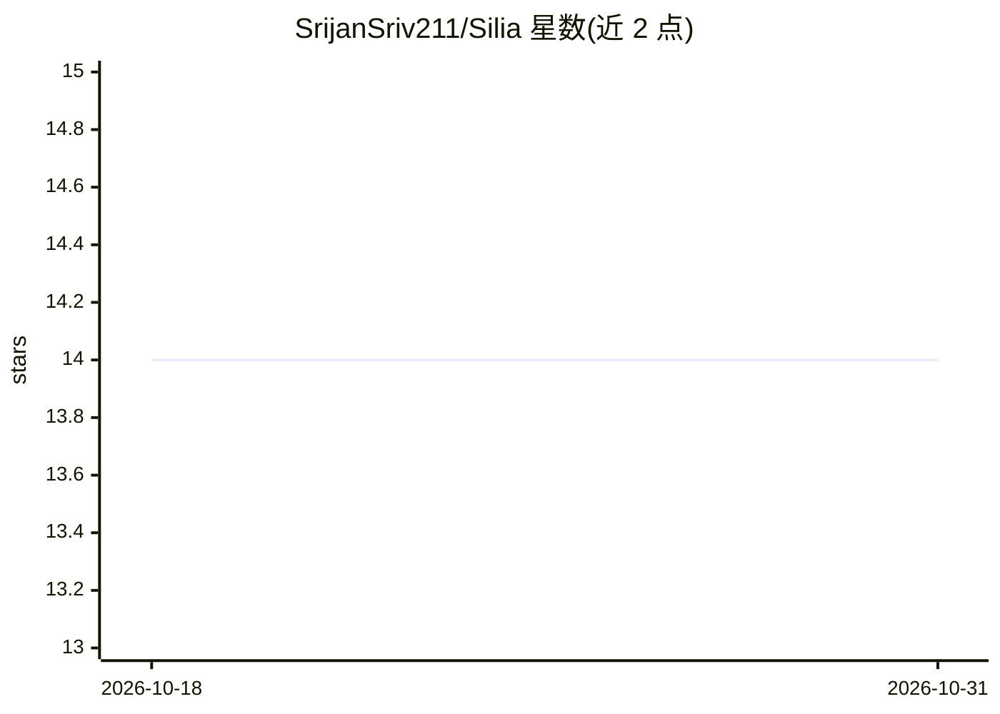

# SrijanSriv211/Silia

⭐ 14 · Python · MIT · 推送 2026-07-23 · [GitHub](https://github.com/SrijanSriv211/Silia) · 个人维护

**极小参数量场景下的 Transformer 替代架构论文（Silia）**

个人研究者撰写的架构论文：提出 Silia（Silu in Attention），将 Attention 层与 SwiGLU 前馈层融合以降低每块参数量，面向 1 亿参数以下的建模与分类任务；配套 Hydra Latent Attention（HLA），组合 Apple 的 AFT/XSA、Qwen 的 Gated Attention/HydraHead、DeepSeek 的多头潜在注意力，以降低 KV cache 与计算开销。README 以公式推导为主，训练基于 Fineweb-edu 数据集，在 HellaSwag、PIQA、LAMBADA 上报告验证损失与生成质量。

## 筛选速览

| 维度 | 判定 | 备注 |
|---|---|---|
| AI 角色 | `ai-native` | 本体是模型或模型工具 |
| 许可风险 | `permissive` | MIT |
| 部署形态 | `None` |  |
| 模型依赖 | — | README 未给出锁定关系 |
| 硬件要求 | — | 无带数字的原话,不猜 |
| 安装摩擦 | `low` | 无编译、无系统依赖或容器化 |
| 成熟度 | — | 结构信号不足 |

## 能力要点

- 将 Attention 与 SwiGLU 融合为单一 Silia 块，面向 1 亿参数以下规模
- HLA 混合 XLA（潜在注意力+门控+XSA）与 Apple AFT，按头交错分配
- KV cache 存 K/V 下投影以省内存
- 在 Fineweb-edu 上训练并报告 HellaSwag/PIQA/LAMBADA 基准结果

## 适用场景

- 研究极小参数量语言模型的架构设计
- 复现或借鉴 HLA 注意力机制做小模型实验
- 了解 Attention 与前馈层融合的参数节省思路

## 场景标签

 · 领域:机器学习研究/模型架构

## 证据(README 行号)

> L10: ## Abstract
> L16: This is where I introduce my neural network architecture which merges the _Attention_ layer with the _SwiGLU Feed F

## 星数曲线

2026-10-18 14 → 2026-10-31 14（+0）

---
*卡片 v1 · prompt 1.4 · 生成 2026-10-31 · 置信度 high · 依据 README sha `010d267a92d2` · [字段定义](../../DATASET.md)*
