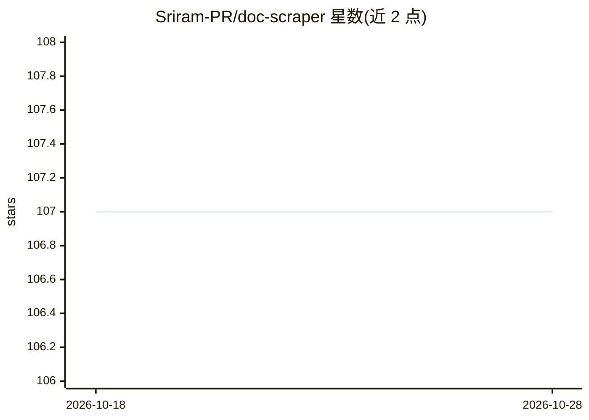

# Sriram-PR/doc-scraper

⭐ 107 · Go · Apache-2.0 · 推送 2026-10-26 · [GitHub](https://github.com/Sriram-PR/doc-scraper) · [官网](https://sriram-pr.github.io/doc-scraper/) · 个人维护

**抓取文档站点转 Markdown 并通过 MCP 供编程代理离线检索**

Go 编写的可配置并发爬虫，专抓技术文档站点：识别 30+ 文档生成器（Docusaurus、Sphinx、VitePress 等）并验证内容选择器，将正文转为 GitHub-Flavored Markdown，输出 llms.txt 等文件。内置 BM25 离线全文检索与页面读取，通过 MCP 服务器（11 个工具）向 Claude Code 等编程代理提供离线文档检索。支持 robots.txt、断点续爬、增量重爬与并行爬取，无遥测。提供二进制、go install、Docker 与 MCPB 安装包。

## 筛选速览

| 维度 | 判定 | 备注 |
|---|---|---|
| AI 角色 | `ai-ecosystem` | LLM/agent 周边工具 |
| 许可风险 | `permissive` | Apache-2.0 |
| 部署形态 | `desktop` | 安装包/桌面程序 |
| 模型依赖 | — | README 未给出锁定关系 |
| 硬件要求 | — | 无带数字的原话,不猜 |
| 安装摩擦 | `low` | 无编译、无系统依赖或容器化 |
| 成熟度 | — | 结构信号不足 |

## 能力要点

- 识别 30+ 文档生成器框架并自动草拟配置
- 输出 GFM Markdown、pages.jsonl、llms.txt、llms-full.txt
- MCP 服务器提供 BM25 离线检索（search_docs）与页面读取（read_page）等 11 个工具
- robots.txt 合规、断点续爬、增量重爬与并行爬取

## 适用场景

- 为 RAG 或训练数据准备干净的文档语料
- 让编程代理离线检索官方文档而非猜测或联网搜索
- 持续跟踪文档站点更新并做增量重爬

## 场景标签

`网页抓取` · 领域:效率与自动化

## 证据(README 行号)

> L13: doc-scraper crawls documentation sites into clean Markdown and serves them to coding agents over MCP. Your agent se
> L19: - **Offline search for agents:** BM25 full-text search (`search_docs`) and page reads (`read_page`) over the stored

## 星数曲线

2026-10-18 107 → 2026-10-28 107（+0）

---
*卡片 v1 · prompt 1.4 · 生成 2026-10-23 · 置信度 high · 依据 README sha `ed7bf407bf73` · [字段定义](../../DATASET.md)*
