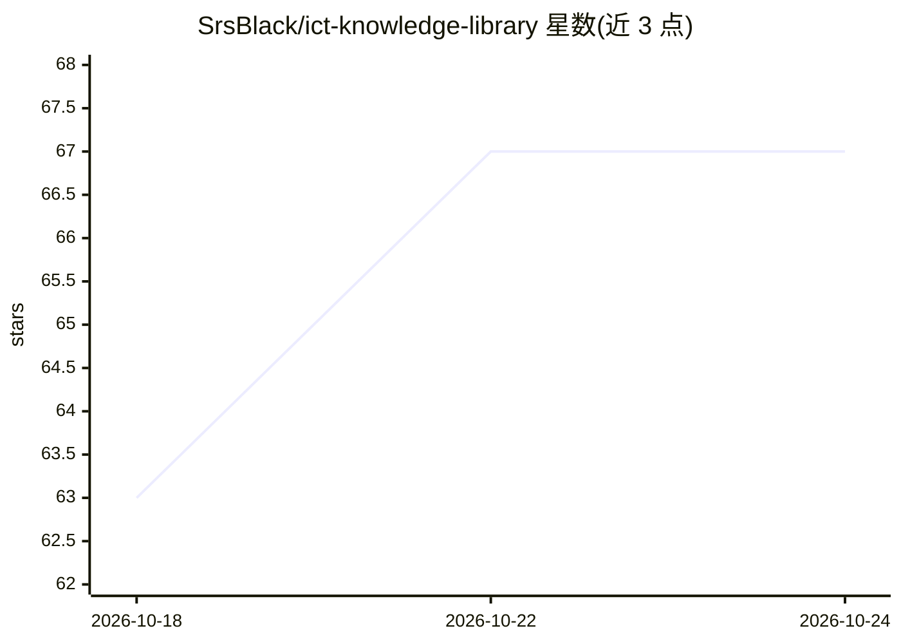

# SrsBlack/ict-knowledge-library

⭐ 68 · Python · 推送 2026-10-09 · [GitHub](https://github.com/SrsBlack/ict-knowledge-library) · 个人维护

**ICT 交易概念的 LLM 可维护知识库（226 个概念文件）**

收录 Inner Circle Trader（ICT）2016–2026 年公开的概念、策略与命名模型，共 226 个概念文件、33 个目录。每个概念独立成 Markdown 文件，含定义、判据、示例、常见错误、交叉链接与来源引用，并附带机器可读 JSON 块（id、category、criteria、confidence、year 等字段）供 RAG 与 agent 系统确定性消费。采用 Karpathy LLM Wiki 模式，由 LLM 按 AGENTS.md 规则维护。明确定位为定义库：不含回测、行情数据、券商集成或表现结果。未声明许可。

## 筛选速览

| 维度 | 判定 | 备注 |
|---|---|---|
| AI 角色 | `ai-knowledge` | 知识聚合/清单类 |
| 许可风险 | `none` | — |
| 部署形态 | `None` |  |
| 模型依赖 | — | README 未给出锁定关系 |
| 硬件要求 | — | 无带数字的原话,不猜 |
| 安装摩擦 | `low` | 无编译、无系统依赖或容器化 |
| 成熟度 | — | 结构信号不足 |

## 能力要点

- 226 个概念文件，每个含 10 个必需章节与机器可读 JSON 块
- Karpathy LLM Wiki 三层模式：原始来源 / wiki / schema（AGENTS.md）
- ICT Confidence 分级（high/medium/community-attributed/disputed/demo-stage）
- 通过全部校验：JSON 均可解析、零断链、零孤立引用（43 个稳定 Source ID）

## 适用场景

- 作为 RAG 或 agent 系统的 ICT 概念知识源，解析 JSON 做确定性查询
- 按 READING-ORDOR 的初中高三条学习路径系统学习 ICT 框架
- 由 LLM 依据 AGENTS.md 持续摄取新来源并维护知识库

## 场景标签

`金融量化` · 领域:学习与行业

## 证据(README 行号)

> L3: A canonical, machine-readable reference of every Inner Circle Trader (ICT) concept, strategy, and named model publis
> L5: **226 concept files** across 33 directories. Each concept lives in its own self-contained markdown file with a stabl
> L9: This library implements Andrej Karpathy's LLM Wiki pattern: a structured, interlinked collection of markdown files m

## 星数曲线

2026-10-18 63 → 2026-10-24 67（+4）

---
*卡片 v1 · prompt 1.4 · 生成 2026-10-24 · 置信度 high · 依据 README sha `b1e6d058de8d` · [字段定义](../../DATASET.md)*
