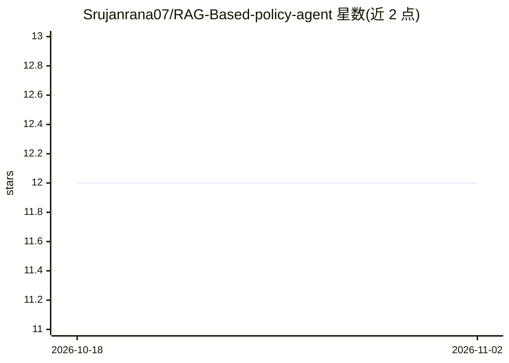

# Srujanrana07/RAG-Based-policy-agent

⭐ 12 · Python · MIT · 推送 2025-11-27 · [GitHub](https://github.com/Srujanrana07/RAG-Based-policy-agent) · 个人维护

**面向企业政策文档的 RAG 问答平台：PDF 转可检索的政策助手**

将政策、合规规则类 PDF 转换为可问答的知识库：用 GhostScript 提取文本、Camelot-py 检测表格，经 Sentence Transformer 嵌入分块后存入 FAISS 索引；用户提问时按语义检索 Top-k 片段，交由 Gemini 生成限定在检索上下文内的回答。以 Flask REST API 形式提供 /upload、/extract、/query 三个端点，支持 Docker 与 Linux 脚本部署，面向合规审计、法务与企业政策团队。需配置 GEMINI_API_KEY。

## 筛选速览

| 维度 | 判定 | 备注 |
|---|---|---|
| AI 角色 | `ai-native` | 本体是模型或模型工具 |
| 许可风险 | `permissive` | MIT |
| 部署形态 | `self-host` | docker 或自建部署 |
| 模型依赖 | — | README 未给出锁定关系 |
| 硬件要求 | — | 无带数字的原话,不猜 |
| 安装摩擦 | `low` | 无编译、无系统依赖或容器化 |
| 成熟度 | — | 结构信号不足 |

## 能力要点

- GhostScript 文本提取 + Camelot-py 表格检测的 PDF 摄取管线
- Sentence Transformer 嵌入 + FAISS Top-k 语义检索
- Gemini 基于检索上下文作答的 REST API（/upload、/extract、/query）
- Docker 与 deploy.sh 部署，记录日志至 log.txt

## 适用场景

- 企业内部政策与合规文档的自然语言问答
- 上传政策 PDF 后直接提问获取带上下文依据的回答
- 通过 REST API 接入门户或 BI 工具做政策查询

## 场景标签

`RAG` `文档问答` `聊天机器人` · 领域:对话与助手

## 证据(README 行号)

> L4: Transform fragmented regulatory PDFs into a **searchable, intelligent, context-grounded policy assistant** using sem
> L67: - Gemini LLM integrated through `gpt_client.py`

## 星数曲线

2026-10-18 12 → 2026-11-02 12（+0）

---
*卡片 v1 · prompt 1.4 · 生成 2026-11-01 · 置信度 mid · 依据 README sha `05babfb1fbfb` · [字段定义](../../DATASET.md)*
