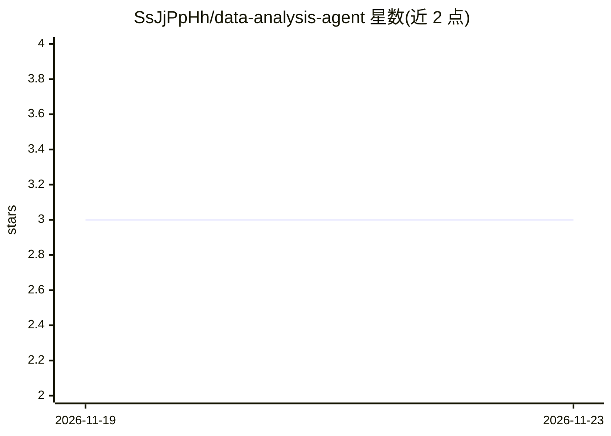

# SsJjPpHh/data-analysis-agent

⭐ 3 · Python · Apache-2.0 · 推送 2026-10-12 · [GitHub](https://github.com/SsJjPpHh/data-analysis-agent) · 个人维护 · 中文 README

**面向科研人员的 AI + R 本机统计分析工作台**

本机运行的 AI + R 统计工具：用户上传研究数据，通过自然语言描述或从 8 个领域共 213 个固定脚本模板发起分析；应用负责数据检查、冻结分析方案、依赖准备，调用用户本机的 R 与 R 包完成计算，并集中展示结果、诊断与导出材料。AI 部分固定接入 DeepSeek API，由用户自行配置 Key；实际数值、模型与图形由本机 R 生成。以源码方式运行，PySide6/Qt WebEngine 提供窗口，Flask/Waitress 提供本地服务，按单机单用户设计。

## 筛选速览

| 维度 | 判定 | 备注 |
|---|---|---|
| AI 角色 | `ai-native` | 本体是模型或模型工具 |
| 许可风险 | `permissive` | Apache-2.0 |
| 部署形态 | `desktop` | 安装包/桌面程序 |
| 模型依赖 | locked-api |  |
| 硬件要求 | — | 无带数字的原话,不猜 |
| 安装摩擦 | `medium` | 含编译或系统依赖之一 |
| 成熟度 | — | 结构信号不足 |

## 能力要点

- 8 个领域共 213 个固定脚本模板，按稳定 ID 接入固定 R 实现
- Agent 六工具编排：数据检查、冻结方案、执行 R、查询包等
- 本机 R 计算，导出含代码、环境、随机数状态的复现交付包
- 模型外发控制：默认仅发送筛选后的汇总结果

## 适用场景

- 做临床研究、公共卫生等领域的统计分析与图表制作
- 用自然语言描述研究问题生成定制 R 分析
- 导出含代码与环境的交付包供合作者复核结果

## 场景标签

`数据分析` `科研工具` · 领域:效率与自动化

## 证据(README 行号)

> L11: 科研统计工作台是一个本机运行的 **AI + R 科研统计分析工具**。你可以上传研究数据，用自然语言描述问题，或从内置分析模板开始；应用负责连接数据检查、分析方案、依赖准备、本机 R 计算、结果查看和导出，把这些步骤放在同一个工
> L13: 项目提供 **8 个领域、213 个固定脚本模板**，覆盖基础统计、临床研究、公共卫生、临床试验与证据合成、行为与社会科学、机器学习、时间空间与文本、组学与生物信息。需要定制分析时，Agent 也可以根据研究问题、冻结方案和本机 
> L62: AI 负责理解需求、组织工具调用和解释允许发送的结果；实际数值、模型和图形由本机 R 计算。当前源码固定接入 **DeepSeek API**，用户配置自己的 API Key。

## 星数曲线

2026-11-19 3 → 2026-11-23 3（+0）

---
*卡片 v1 · prompt 1.4 · 生成 2026-11-22 · 置信度 high · 依据 README sha `b705e54dddcf` · [字段定义](../../DATASET.md)*
